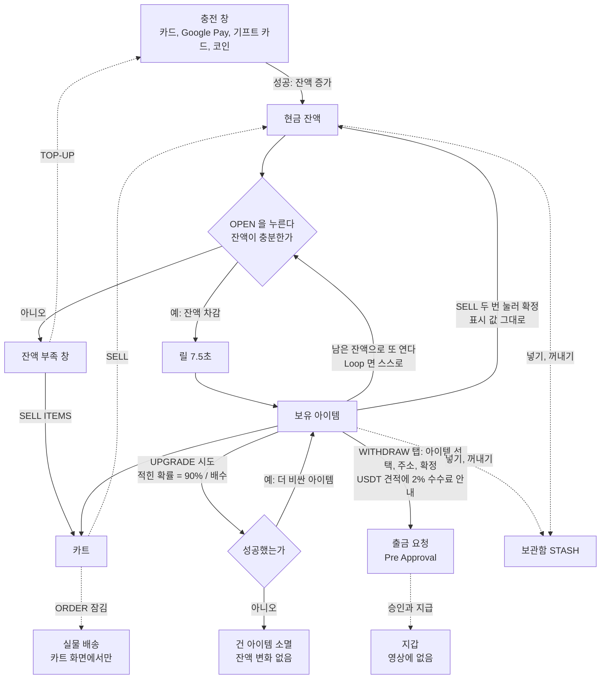

# HYPEDROP 서비스 플로우

녹화 `녹화_2026_10_12_15_04_25_724.mp4` (11분 15초, 2536x1280, 30fps, 20,250프레임)를 Claude 와 Codex 가 따로 분석하고, 세 번에 걸쳐 서로 반박해서 맞춘 결과다. 2026-10-12.

## 0. 한눈에

- 이 서비스의 자산은 두 상자다. **현금 잔액**과 **보유 아이템**. 충전은 잔액을 늘리고, 개봉은 잔액을 줄여 아이템을 만든다.
- 아이템으로 할 수 있는 일은 넷이다. 표시 값 그대로 팔아 잔액으로 돌리기, 배수를 걸어 업그레이드하기, 코인으로 출금 요청하기, 그대로 두기.
- 영상에서 본 출금 창은 **잔액이 아니라 아이템을 고르게** 되어 있다. 잔액 $59.94 가 있어도 아이템이 없으면 출금 목록이 비어 있었다. 잔액을 바로 빼는 다른 길이 있는지는 영상에 없다.
- 업그레이드 창에 적힌 성공 확률은 본 네 가지 배수에서 모두 **90% 를 배수로 나눈 값**이었다. 그 확률이 실제라면 걸 때마다 기댓값으로 10% 가 빠진다.
- 영상의 사용자는 $59.94 를 넣고 박스 16개에 $60.27 을 썼다. $29.65 짜리 한 번에서 $55.00 이 나왔고, 나머지 15번($30.62)에서 나온 것은 합쳐 **$0.85** 였다.
- 끝 상태: 잔액 $0.25, 남은 아이템 $0.02 한 개, 그리고 아이템 7개($55.12)의 USDT 출금 요청이 "Pre Approval" 로 걸려 있다. 지갑에 들어왔는지는 영상에 없다.
- 한 개를 열면 누른 뒤 결과만 남을 때까지 **7.5초**로 일정하다. 여러 개는 약 8초, 업그레이드는 약 6.2초다.
- **배송을 지양하는 흐름이다**(파운더가 써 보고 알려 준 것). 아이템은 출금 창에서 그 값으로 코인 출금을 할 수 있고, 배송을 받으려면 다른 화면으로 가야 한다. 영상에서도 그렇게 보인다(7-1절).

## 1. 분석 방법과 믿을 수 있는 정도

| | Claude | Codex (gpt-6-astra) |
|---|---|---|
| 본 것 | 1초 간격 675장 전부(훑어보기 판 34장), 핵심 원본 약 60장, 연출 구간은 30fps 로 측정 | 1초 간격 603장(훑어보기 판 31장). 1차에서 원본 292장, 2차와 3차에서 지정 구간과 다툰 곳을 다시 엶 |
| 프레임을 못 받은 구간 | 없음 | 카드 번호 입력(92~103초, 125~165초), 다른 앱 화면(505~512초), 본인 인증 화면(636~646초). 개인 정보라 빼고 줬다 |
| 일부를 가린 구간 | 없음 | 513~517초의 출금 주소와 USDT 수량 칸 |

진행: ① 서로 모르게 1차 분석 → ② Claude 가 Codex 를 반박 → ③ Codex 가 프레임을 다시 열어 Claude 를 반박하고 Claude 의 반박에 답함 → ④ Claude 가 이 문서의 초안을 씀 → ⑤ Codex 가 초안을 프레임과 대조해 스물두 군데를 지적 → ⑥ 반영.

표기
- **확인**: 화면이 바뀌거나 숫자가 바뀌는 것을 봤다.
- **표시**: 단추나 문구만 봤다. 눌러 본 결과는 없다.
- **짐작**: 앞뒤 화면으로 이은 것.
- 대괄호 안의 숫자는 영상의 초다.
- **Claude 만 봄**: Codex 에게 주지 않은 구간이라 한 사람만 확인한 것이다. 맞춰 보지 못했다.

## 2. 뼈대

실선은 영상에서 실제로 일어난 것, 점선은 단추나 문구만 본 것이다.

고리는 넷이다: **충전 → 개봉 → 결과 처리 → 다시 열거나 뺀다.** 인증, 약관 창, 카트, 보관함, 기록, 추천은 이 고리에 끼어드는 곁가지다. 출금과 보관함은 카트를 거치지 않고 각자의 창에서 아이템을 고른다.

## 3. 서비스 플로우 (갈림길마다 예와 아니오)

### 3-1. 충전

| 갈림길 | 예 | 아니오 | 상태 |
|---|---|---|---|
| 지금 충전하는가 | 위쪽 잔액 옆 초록 + 단추 → 충전 창 | 홈이나 박스 목록을 본다. 충전은 탐색의 선행 조건이 아니다. 탐색하다가 창을 열고 닫아도 제자리로 돌아온다 | 확인 [0, 442~444] |
| 프로모션 코드를 넣는가 | 코드 입력 → APPLY. 창에 "PROMO CODE "HypeDrop" 5% bonus" | 그냥 수단을 고른다 | 빈 칸으로 APPLY 하면 "This field is required" [3~4]. 유효한 코드가 붙는 것은 표시뿐 |
| 어떤 수단인가 | **CARDS**: 금액($5~$1,000 단추 또는 입력) → DEPOSIT → 카드 폼(Name, Card Number, MM/YY, Security code, Remember this card) → PAY → 은행 인증. **코인**: 누르면 내 전용 입금 주소와 QR, 계산기 | **GOOGLE PAY**: 금액 화면까지 봤다. **GIFT CARD**: 선택지만 봤다 | 카드와 코인은 확인 [1, 19, 74]. Google Pay 는 표시 [115] |
| 카드 결제가 됐는가 | "TRANSACTION COMPLETE", Top-up Amount $10.00, 잔액 +$10 | 은행 화면에 "Card Issue ... BS00002: Generic Business Error" → "THE TRANSACTION FAILED ... no funds have been added to your account" 와 Transaction ID. 같은 창에서 수단을 바꾸거나 다시 시도 | 실패 [110~114], 성공 [173] 확인 |
| 코인이 들어왔는가 | 달러로 환산돼 잔액에 들어온다. 영상에서는 $49.94 | 기다린다. 주소 화면에 머물 필요는 없다. 영상에서는 카드 화면으로 옮겨 간 뒤에 반영됐다 | 확인 [68초 $0.00 → 69초 $49.94]. 바깥 지갑에서 보내는 장면은 없다. 계산기에 50 을 넣은 것[51]과 기록의 "Layer 1 (USDT) Deposit Completed $49.94"[614]로 50 USDT 를 보냈다고 **짐작** |

코인 수단(창 왼쪽): ETH, BTC, SOLANA, USDT(ERC-20), LTC, USDT(TRC20), USDC, DAI.

### 3-2. 고르기와 개봉

| 갈림길 | 예 | 아니오 | 상태 |
|---|---|---|---|
| 고른 것이 박스인가 | 박스 화면 | 홈의 줄에는 박스와 낱개 상품이 섞여 있다. 낱개 상품($22 부스터)을 누르자 그 상품을 목표로 한 DEALS 화면이 열렸다 | 확인 [207~210, 213~219] |
| 구성품과 확률을 보는가 | 박스 화면 아래: BEST UNBOXINGS, RECENTLY UNBOXED, ITEMS IN THIS BOX(아이템마다 확률, HIDE ROLL CHANCES) | 바로 연다 | 확인 [351~357]. OP-17 의 맨 위 아이템은 $3,025.79 에 0.000001% |
| FREE TRY 인가 | 돈 없이 같은 릴이 돌고 결과가 나온다. 잔액 그대로, SELL 과 UPGRADE 단추가 없다 | 수량(1~6)과 Loop(∞)를 정한다. 둘은 따로 켜고 끈다 | 확인 [222~231]. 체험 결과가 내 것이 아니라는 것은 그 뒤 출금 목록이 비어 있던 것[337]으로 **짐작** |
| OPEN 을 눌렀는가 | 잔액 검사 | 수량만 바꿔 미리 볼 수 있다. 수량 6 이면 릴 여섯 열과 "OPEN FOR $8.16" 이 보이지만 돈은 안 나간다 | 확인 [403~406] |
| 잔액이 충분한가 | 차감 → 릴 → 결과. 장부에는 박스마다 한 줄씩 적힌다 | "Oops, your balance is too low" [TOP-UP] [SELL ITEMS]. SELL ITEMS 는 카트로 갔다. TOP-UP 은 눌러 보지 않았다 | 확인 [300~308, 477~482, 607] |
| Loop 가 켜져 있는가 | 같은 수량으로 다음 회차를 또 여는 것으로 보인다 | 이번 회차로 끝 | 6개와 Loop[289], 5개와 Loop[466] 확인. 477초의 부족 창이 Loop 의 다음 회차 때문이라는 것은 **짐작**(476초까지 STOP LOOP 가 떠 있었고 새로 누른 흔적이 없다) |
| STOP LOOP 를 눌렀는가 | 다음 회차만 멈춘다. 지금 돌던 것은 결과까지 나온다 | 계속 | 확인 [304~308] |

박스 화면의 단추: BACK, FAIRNESS GUARANTEED, 소리, OPEN FOR, FREE TRY, 수량 1~6, ∞(Loop), SPEEDRUN, ADD TO FAVORITE. SPEEDRUN 은 켜 보지 않았다.

### 3-3. 결과 처리

유료 결과는 수령 단추 없이 보유 목록(카트, 출금 창, 보관함 창)에 나타난다. 결과 아래에 [UPGRADE n ITEMS] [SELL (n) FOR $x] 가 뜬다. 결과를 둔 채 남은 잔액으로 바로 또 열 수 있다.

| 갈림길 | 예 | 아니오 | 상태 |
|---|---|---|---|
| SELL 을 눌렀는가 | 단추가 "CLICK AGAIN TO SELL" 로 바뀐다. 아직 팔리지 않았다 | 가지고 있는다 | 확인 [321] |
| 한 번 더 눌렀는가 | "Your item has been sold successfully." 잔액 + 표시 값 | 확인 대기에 남는다. 그냥 두면 어떻게 되는지는 못 봤다 | 6개 묶음 판매 확인 [324, 325]. 값 합 $0.58, 잔액 +$0.58 |
| UPGRADE 를 눌렀는가 | 창: 내 아이템 → 목표 아이템, Multiplier(+1, 1/2, X2), "ATTEMPT UPGRADE nn% SUCCESS" | 가지고 있는다 | 확인 [249] |
| 배수가 1.20 이상인가 | 목표 아이템과 확률이 나온다 | "Multiplier should be at least 1.20", 시도 단추 흐림 | 확인 [388, 390] |
| ATTEMPT 를 눌렀는가 | "Attempting upgrade..." 약 6.2초 | 배수를 바꾸거나 닫는다 | 시도 세 번 확인. 닫기는 못 봤다 |
| 성공했는가 | "Success" + CONTINUE UPGRADING. 더 비싼 아이템으로 바뀐다 | "The Upgrade Failed" + CLOSE. 건 아이템이 사라지고 잔액은 그대로다 | 성공 1번[384], 실패 2번[281, 398] |
| 성공한 것을 또 거는가 | 새 아이템이 원본이 되어 같은 창으로 | 가지고 있는다 | 예 확인 [384~390] |

업그레이드 창의 설명 원문: "If your upgrade is successful, you will receive a higher value item and/or credits. If your upgrade fails, your existing items will be destroyed - though, you'll receive XP for your loss." credits 로 받는 경우와 XP 의 양은 영상에 없다.

### 3-4. 빼기 (코인 출금 요청)

충전 창의 WITHDRAW 탭이다. 카트를 거치지 않는다.

| 갈림길 | 예 | 아니오 | 상태 |
|---|---|---|---|
| 보유 아이템이 있는가 | 목록에 아이템이 체크 칸과 함께 뜬다 | "SELECT ITEMS TO WITHDRAW" 아래가 비어 있다. 금액을 적는 칸은 없다 | 잔액 $59.94 에 빈 목록 [181] |
| 아이템을 골랐는가 | "n ITEMS SELECTED - TOTAL $x", NEXT 활성 | 0 ITEMS SELECTED, NEXT 흐림 | 있지만 안 고른 상태 [429], 고른 상태 [430] 확인 |
| 고른 것을 바꾸는가 | EDIT | 견적과 주소 화면에서 진행 | EDIT 는 표시 [433, 504] |
| 주소를 넣었는가 | WITHDRAW $x → Confirmation 창 | 단추 흐림. 닫으면 아무 일 없다 | 확인 [435~437, 514~515] |
| 확정했는가 | "Withdraw requested successful" | "Please confirm within 46 seconds" 가 줄어드는 대기 상태 | 확인 [515~518]. 시간이 다 되면 어떻게 되는지는 못 봤다 |
| 승인되고 지급됐는가 | (영상에 없음) | TOP-UPS 기록에 "Withdrawal, Pre Approval, $55.12" | Pre Approval 까지만 확인 [614] |

요청 뒤에 다시 연 출금 목록은 비어 있었고[531], 잔액은 $1.77 그대로였다[518].

출금 화면의 문구(USDT TRC20): "We'll send 53.95624053 USDT to the entered address, 4 confirmation(s) required." "Make sure your withdrawal address and cryptocurrency selected are correct, as not doing so might result in the loss of funds." "Please note, a 2% processing fee will be incurred."

출금 수단(창 왼쪽): BTC, DAI, SOLANA, ETH, USDT(TRC20), LTC, USDT(ERC-20), USDC(ERC-20), XRP, TRX, CARDANO, DOGE, BCH. 견적까지 본 것은 USDT(TRC20) 하나다.

## 4. 곁가지

| 곁가지 | 본 것 | 상태 |
|---|---|---|
| 인증 | 화면 아래에 띠가 떠 있다: "We're missing some important information. To continue using certain features, please upgrade verification." [Complete KYC] [Dismiss]. 계정의 VERIFICATION: Tier 1 BASIC 완료(Email verified), Tier 2 BEGINNER Available → PROOF OF IDENTITY → START VERIFICATION → 로딩 | 확인 [571~576, 634~635]. Tier 2 가 없는 이 계정에서 충전, 개봉, 판매, 업그레이드, 출금 요청이 됐다. 최종 지급의 조건인지, "certain features" 가 무엇인지는 모른다 |
| 본인 인증 제공자 | START 를 누르면 바깥 제공자 화면(Shufti)이 뜬다: 서류 발급 국가 고르기, 서류 종류(운전면허, 주민증, 여권), 휴대폰으로 옮기라는 안내 | **Claude 만 봄** [636~646]. 끝내지 않고 돌아왔고 Tier 2 는 그대로 Available [647] |
| 약관 창 | "Terms of Service Update ... Please review and accept them to continue." [I AGREE] | 카트[482], 계정[488], 추천[671]에 들어갈 때 한 번씩 떴다. 같은 화면에 다시 들어갈 때는 안 떴다[568, 585]. 까닭은 모른다 |
| 카트(CART) | 내 아이템 목록. 검색, 정렬, SHIPPING STATUS, AVAILABLE TO ORDER, SELECT ALL. 아이템마다 SELL FOR $x 와 ORDER(자물쇠). 아이콘에 "Exchangeable" 말풍선 | 확인 [484, 586~596]. 카트의 SELL 은 눌러 보지 않았다. ORDER 는 주문 화면으로 이어지지 않았다. 자물쇠가 풀리는 조건은 모른다 |
| 보관함(STASH) | 네 가지: DEPOSIT CASH, DEPOSIT ITEMS, WITHDRAW CASH, WITHDRAW ITEMS. 잠금 토글. Total Stash Balance | 표시 [651~660]. 넣거나 꺼내 보지 않았다. 잠금이 무엇을 막는지 모른다 |
| 계정 | LEVEL 1, 7768 / 8300 XP, BUY XP. 탭 열 개: ACCOUNT, STATS, VERIFICATION, CART, FAIRNESS, GAME HISTORY, TRANSACTIONS, TOP-UPS, PROMO CODES, DELIVERIES. Alternative login, Two-Factor authentication | 확인 [489, 524] |
| 기록 | TRANSACTIONS(개봉 하나하나, 판매, 입금, 거래 뒤 잔액), TOP-UPS(입금과 출금의 상태), GAME HISTORY(PVP, UNBOXING, DEALS, QUICK UPGRADE, BLACK MARKET), DELIVERIES(비어 있음), 메시지(비어 있음) | 확인 [599~619, 663] |
| 공정성 | FAIRNESS: CLIENT SEED(CHANGE), SERVER SEED (HASHED)(REVEAL), FUTURE SERVER SEED (HASHED). Previous Seed Pair 는 세 칸 모두 N/A | 표시 [598, 625]. 바꾸거나 공개해 보지 않았다 |
| 통계 | Favourite Box(PITCH BLACK, 7번), Best Unboxed Item($55 스웨트셔츠), Luckiest Box(TROPICAL ESCAPE, $25.35). Hide My Stats From Other Users | 확인 [582] |
| 추천 | "EARN UP TO 10% EVERY TIME YOUR FRIENDS PLAY", "GIVE YOUR FRIENDS A 5% BONUS ADDED TO ALL THEIR CASH TOP-UPS", 추천 코드, CLAIM NOW | 표시 [673] |
| DEALS | 아이템을 고르고 값을 정해 거는 화면. $22 아이템에 "DEAL FOR $19.55", FREE TRY, 1~4 와 ∞, SPEEDRUN, PRICE, CHANCE. 목록에는 $7,000,000 짜리 차도 있다 | 표시 [209]. 실행하지 않았다 |
| 바닥글 | LEAVE YOUR FEEDBACK, 소셜, 결제 로고, Contact, Blog, Faq, Terms of Service, Privacy Statement, Provably Fair, Aml Policy, Free Drop, Live Status | 표시 [409] |
| 못 들어가 본 메뉴 | BATTLES, BLACK MARKET, RACE, FREE DROP | 이름만 |

## 5. 돈의 흐름

### 5-1. 위쪽 잔액이 바뀐 순간

| 초 | 전 | 후 | 까닭 |
|---|---|---|---|
| 69 | $0.00 | $49.94 | USDT(TRC20) 입금 반영 |
| 114 | $49.94 | $49.94 | 카드 $10 실패 |
| 173 | $49.94 | $59.94 | 카드 $10 성공 |
| 233 | $59.94 | $57.28 | PITCH BLACK 1개 |
| 300, 301 | $57.28 | $54.62, $41.32 | PITCH BLACK 6개. 표시는 두 번에 나눠 바뀜 |
| 324 | $41.32 | $41.90 | 6개 판매 +$0.58 |
| 362 | $41.90 | $40.54 | OP-17 1개 |
| 412 | $40.54 | $10.89 | TROPICAL ESCAPE 1개 |
| 468 | $10.89 | $1.77 | FABLED 1개와 5개. 첫 1개 때는 표시가 안 바뀌다가(467초까지 $10.89) 여기서 한 번에 -$9.12 |
| 518 | $1.77 | $1.77 | 아이템 7개 출금 요청. 잔액은 그대로 |
| 554 | $1.77 | $0.25 | FABLED 1개 |

검산: 넣은 돈 59.94 + 판 돈 0.58 - 박스 60.27 = 0.25. 장부(TRANSACTIONS)와 맞는다. 위쪽 잔액 표시와 장부는 다른 것이다. 장부에는 FABLED 가 $1.52 씩 여섯 줄로 따로 적혀 있다.

### 5-2. 박스 16개의 결과

| 박스 | 값 | 연 수 | 쓴 돈 | 나온 것 |
|---|---|---|---|---|
| PITCH BLACK | $2.66 | 7 | $18.62 | $0.11, 그리고 6개 합 $0.58 |
| OP-17 | $1.36 | 1 | $1.36 | $0.02 |
| TROPICAL ESCAPE | $29.65 | 1 | $29.65 | $55.00 |
| FABLED | $1.52 | 7 | $10.64 | $0.02 일곱 번 |
| 합 | | 16 | $60.27 | $55.85 |

$55.00 한 건이 나온 값의 98.5% 다. 나머지 15번은 $30.62 를 쓰고 $0.85 가 나왔다(2.8%). 16번짜리 표본이지 이 서비스의 환급률이 아니다. 무료 체험의 $0.25 와 업그레이드로 잠깐 생긴 $0.04 는 넣지 않았다.

### 5-3. 숫자로 나오는 규칙

- **판매**: 아이템 표시 값의 100%. 0.21 + 0.02 + 0.11 + 0.11 + 0.11 + 0.02 = 0.58 이고 잔액이 $0.58 늘었다. 박스 값 대비가 아니다. 그 6개의 박스 값은 $15.96 이라 박스 값 대비로는 3.6% 다.
- **업그레이드**: 2배 45.00%, 3배 30.00%, 5배 18.00%, 40배 2.25%. 넷 다 90% 를 배수로 나눈 값이다. 적힌 확률이 실제이고 실패하면 0 이 되며 XP 의 값을 0 으로 치면, 건 값의 90% 가 기댓값으로 돌아온다. 본 것은 네 점이고, 실제 추첨을 검증한 것은 아니다.
- **USDT(TRC20) 출금 견적**: $55.00 → 53.95624053 USDT, $55.12 → 54.07396323 USDT. 두 견적의 비율이 0.981023 으로 같다. 화면에 적힌 것은 "2% processing fee" 뿐이다. 2% 를 뗀 값(55 의 98% 는 53.90)에 1.00104 를 곱하면 견적과 맞는다. 이 1.00104 는 화면에서 읽은 환율이 아니라 두 견적에서 **역산한 계수**다. 다른 코인의 견적은 보지 못했다.
- **USDT(TRC20) 입금**: 계산기에서 8 USDT = $7.99065303, 50 USDT = $49.94158144. "Minimum 8 USDT after fees, depositing less will result in loss." "Only send USDT using the TRON network to this address. 4 confirmation(s) required."
- **팔기와 아이템째 빼기**: 아이템을 팔면 잔액이 되고, 영상에서 잔액을 바로 빼는 길은 보이지 않았다. 팔지 않고 아이템째 USDT 출금을 요청하면 견적에서 약 2% 가 빠진다. 영상의 사용자는 $55 스웨트셔츠를 팔지 않고 아이템째 출금을 요청했다.
- **Voucher**: 값이 적힌 HypeDrop 자체 아이템이다. 업그레이드의 목표물로 나왔고($4.40, $0.04) 다른 사람의 결과 목록에도 $50, $25, €10 짜리가 보인다. 릴에 지나가는 HD 동전 그림과 같은 것인지는 모른다.

## 6. 개봉 연출

시간은 Claude 가 30fps 원본에서 릴 영역의 화면 변화를 잰 값이다. 처음 잰 값은 릴이 느려지는 꼬리를 놓쳐 짧았고, Codex 의 지적으로 다시 쟀다. 단계는 Codex 가 1초 프레임으로 읽은 것과 맞췄다.

| 개봉 | 누른 뒤 결과만 남을 때까지 | 그 가운데 빠르게 도는 구간 | 그 뒤 |
|---|---|---|---|
| PITCH BLACK 무료 체험 | 7.47초 [222.43~229.90] | 6.3초 | 이름과 $0.25. SELL 과 UPGRADE 없음 |
| PITCH BLACK 유료 1개 | 7.47초 [232.80~240.27] | 6.4초 | 이름, $0.11, 단추 [240] |
| OP-17 1개 | 7.50초 [362.17~369.67] | 5.1초 | 이름과 $0.02 [369~370], 단추 [371] |
| TROPICAL ESCAPE 1개 | 7.50초 [412.50~420.00] | 약 5초 | $55 의류와 푸른 빛 [420], 단추 [421] |
| FABLED 1개 | 7.50초 [454.60~462.10] | 4.9초 | 이름과 $0.02 [462], 단추 [463] |
| FABLED 마지막 1개 | 7.80초 [554.07~561.87] | | 이름과 $0.02 [561], 단추 [563] |
| PITCH BLACK 6개 | 8.03초 [300.77~308.80] | 7.4초 | 여섯 결과가 한 줄로 정리되며 값과 단추가 함께 [308] |
| FABLED 5개 | 8.10초 [467.87~475.97] | 7.3초 | 값 [475] → 뒤 배경 도형 [476] → 단추와 잔액 부족 창이 함께 [477] |
| 업그레이드 세 번 | 누르고 6.2초 뒤 결과 [274.70~280.90, 377.93~384.10, 391.57~397.80] | | 목표 칸에 줄무늬와 숫자가 차오른다. 실패는 빨강, 성공은 초록 테두리 |

- 한 개는 **가로 릴 한 줄**(오른쪽에서 왼쪽으로), 여러 개는 **세로 열 여러 개**다.
- 한 개 개봉은 박스 값이 $1.36 이든 $29.65 든, 결과가 $0.02 든 $55 든 길이가 7.5초로 같았다.
- 릴에는 가격표 없이 그림만 지나간다. 박스 값보다 비싼 카드와 HD 동전도 같이 지나가고, 멈추기 직전에 HD 동전이 결과 바로 옆에 와 있는 장면이 보였다[228, 559]. 지나가는 그림의 수로 실제 확률을 셈할 수는 없고, 둘이 어떻게 대응하는지는 확인하지 못했다.
- 끝나는 모양: 릴이 느려진다 → 가운데 것이 밝아지고 나머지가 어두워진다 → 이름과 값이 뜬다 → 그것만 남는다 → 뒤 배경 도형 → 단추. 이 단계들은 겹쳐서 일어난다(옆 카드가 남아 있을 때 이름과 값이 먼저 뜨기도 한다[369, 561]). OPEN 단추의 글자는 릴이 끝나기 전에 원래대로 돌아오기도 한다[305, 460].
- 잔액은 OPEN 을 누른 직후, 릴이 돌기 시작할 때 이미 빠져 있다[233, 362, 412]. FABLED 첫 개봉에서만 표시가 늦었다.

## 7. 사용자를 다시 돌리게 만드는 장치 (화면에서 본 것)

| 장치 | 어디서 |
|---|---|
| FREE TRY: 돈 없이 같은 릴을 돌려 본다 | 박스 화면 [222] |
| 수량 1~6 과 Loop. SPEEDRUN 토글(켜 보지 않음) | 박스 화면 [289, 466] |
| 결과 바로 아래의 UPGRADE, 성공하면 CONTINUE UPGRADING | 결과, 업그레이드 창 [242, 384] |
| 결과 바로 아래의 SELL: 두 번 누르면 잔액으로, 바로 다시 열 수 있다 | 결과 [321~326] |
| 잔액 부족 창의 TOP-UP 과 SELL ITEMS | [477] |
| LIVE DROPS: 결과 목록이 화면 오른쪽에서 계속 바뀐다. 싼 것($11)과 비싼 것($346)이 섞여 있고 달러와 유로가 섞여 있다. 실제 다른 사람의 결과인지는 확인할 수 없다 | 본 화면 거의 전부 |
| RACE 카운트다운("Ending: 01d 16h ...") | 본 화면 거의 전부 |
| XP 와 LEVEL, BUY XP, 실패해도 XP 를 준다는 문구 | 계정, 업그레이드 창 [249, 489] |
| BEST UNBOXINGS(€17,000 세 개)와 RECENTLY UNBOXED($0.02 여러 개)가 나란히 | 박스 화면 [353] |
| 프로모션 5%, 추천 최대 10% | 충전 창, 추천 [1, 673] |
| 통계: 가장 많이 연 박스, 가장 좋은 결과, 가장 운 좋았던 박스 | 계정 [582] |

이것들이 실제로 재방문을 늘리는지는 영상으로 알 수 없다.

## 7-1. 배송을 지양하는 설계

파운더가 직접 써 보고 알려 준 것(영상 밖의 지식): **출금 창에서 아이템을 그 값으로 뺄 수 있다. 배송을 받으려면 다른 화면으로 가야 한다. 배송을 지양하는 프로세스다.**

영상에서 이 말과 맞는 것들이다.

| 손이 닿는 거리 | 코인으로 바꾸는 길 | 실물로 받는 길 |
|---|---|---|
| 결과가 나온 자리 | [UPGRADE] [SELL] 둘이 바로 아래에 뜬다 [242, 421] | 단추가 없다 |
| 어느 화면에서나 | 위쪽 + 단추 → WITHDRAW 탭 → 아이템 체크 → 주소 → 확정. 홈에서도 계정에서도 열렸다 [430, 499] | 없다 |
| 잔액이 모자랄 때 | 창에 [TOP-UP] [SELL ITEMS] [477] | 없다 |
| 카트 화면까지 가면 | SELL FOR $x 가 초록 단추로 위에 [484] | ORDER 가 그 아래에 자물쇠와 함께. 눌러도 주문 화면이 안 열렸다 [586~596] |
| 기록 | TOP-UPS 에 출금 요청이 바로 잡힌다 [614] | DELIVERIES 는 "No Delivery Yet" [602] |

- 실물인 $55 스웨트셔츠도 영상의 사용자는 배송이 아니라 USDT 출금으로 처리했다 [430, 499~518].
- 값은 아이템 표시 값 기준이다. 판매는 100% 가 잔액으로, USDT 출금은 2% 수수료가 붙는다(5-3절).
- 카트의 필터에 SHIPPING STATUS 와 AVAILABLE TO ORDER 가 있다 [485]. 주문할 수 없는 아이템이 따로 있다는 뜻으로 보이지만 조건은 영상에 없다.

## 8. 서로 고친 것과 끝까지 갈린 것

**Claude 가 틀렸고 Codex 가 고친 것**
- FABLED 첫 개봉 때 위쪽 잔액이 $9.37 이 됐다고 썼다. 화면은 467초까지 $10.89 였고 468초에 $1.77 이 됐다. $9.37 은 장부의 중간 잔액이다.
- 싼 결과 15개의 합을 $0.92 라고 썼다. $0.85 가 맞다. 카드 하나를 두 번 셌다.
- "스웨트셔츠를 뺐다"고 썼다. 요청했고 Pre Approval 이다.
- Loop 를 "멈출 때까지 계속"이라고 썼다. 잔액 검사가 빠졌다.
- 초를 틀렸다: 판매 반영은 324초, 마지막 개봉은 554초, 출금 요청 성공은 518초. 추천 문구의 "UP TO"를 빼먹었다.
- 빠뜨렸다: 빈 코드 오류, 배수 최소 1.20, 3배 30%, Exchangeable, 메시지 창, 수량 미리 보기, 홈의 낱개 상품이 DEALS 로 간다는 것.
- 초안의 그림에서 업그레이드 실패의 화살을 잔액으로 보냈고, 카트를 출금의 관문처럼 그렸다. 릴의 길이도 꼬리를 놓쳐 5~6.4초로 적었다. 셋 다 3차에서 고쳤다.

**Codex 가 틀렸거나 모자랐고 Claude 가 짚은 것**
- 한 개 개봉의 릴을 세로라고 썼다. 가로다. Codex 가 받아들였다.
- 1차에 잔액 검산은 있었지만 업그레이드의 기댓값, 출금 견적의 비율, 결과의 쏠림은 계산하지 않았다. Claude 가 요구했고, Codex 가 2차에서 직접 계산해 조건을 붙여 받아들였다. Codex 가 붙인 조건(본 것은 네 점, 역산한 계수, 표본 16개)은 이 문서에 그대로 넣었다.
- 1차의 플로우가 스물한 칸으로 평평했다. 2차에서 Codex 가 고리와 곁가지로 나눈 안을 냈고 3절과 4절이 그 안을 따른다.
- 1차에서 홈 구간 둘을 원본으로 열지 않았다. 2차에서 다시 열어 낱개 상품과 DEALS 의 연결을 찾아냈다.

**끝까지 갈린 것**
1. 잔액을 직접 뺄 수 있는가. Claude: 본 출금 창에 금액 칸이 없고 아이템만 고르니 이 서비스의 뼈대로 봐야 한다. Codex: 그 창의 규칙은 맞지만 서비스 전체에 다른 길이 없다는 증거는 아니다. → 이 문서는 "영상에서 본 출금 창은 아이템만 고른다"까지만 적었다.
2. 505~512초와 636~646초. Codex 는 프레임을 받지 못해 "근거 없는 서술"이라고 했다. Claude 는 원본을 봤다(받을 주소를 다른 앱에서 가져오는 장면, 바깥 본인 인증 화면). 둘이 맞춰 볼 수 없는 구간이라 "Claude 만 봄"으로 표시했다.
3. Loop 와 잔액 부족 창의 인과. 둘 다 "Loop 의 다음 회차가 걸린 것으로 보인다"는 데는 같다. Codex 는 누른 기록이 없으니 짐작으로 두라고 했고 그렇게 뒀다.

## 9. 영상으로는 알 수 없는 것

- 가입, 처음의 이메일 인증, 로그인.
- 출금이 승인되고 지갑에 들어오는지, 걸리는 시간, Tier 2 인증이 그 조건인지.
- 잔액을 아이템 없이 바로 빼는 길이 있는지.
- 실물 주문(ORDER)의 자물쇠가 풀리는 조건, 배송비, 배송 절차. 배송이 다른 화면에 있다는 것은 파운더가 알려 줬고, 그 화면 안은 영상에 없다. Exchangeable 이 무엇과 바꾸는 것인지.
- 보관함의 잠금이 무엇을 막는지.
- BATTLES, BLACK MARKET, RACE, FREE DROP 의 안쪽. DEALS 를 실행했을 때의 결과.
- SPEEDRUN 을 켰을 때의 속도.
- 프로모션 코드와 추천 보상이 실제로 붙는지.
- 화면에 적힌 확률과 공정성 시드가 실제 추첨과 맞는지.
- 약관 창이 뜨는 조건.
