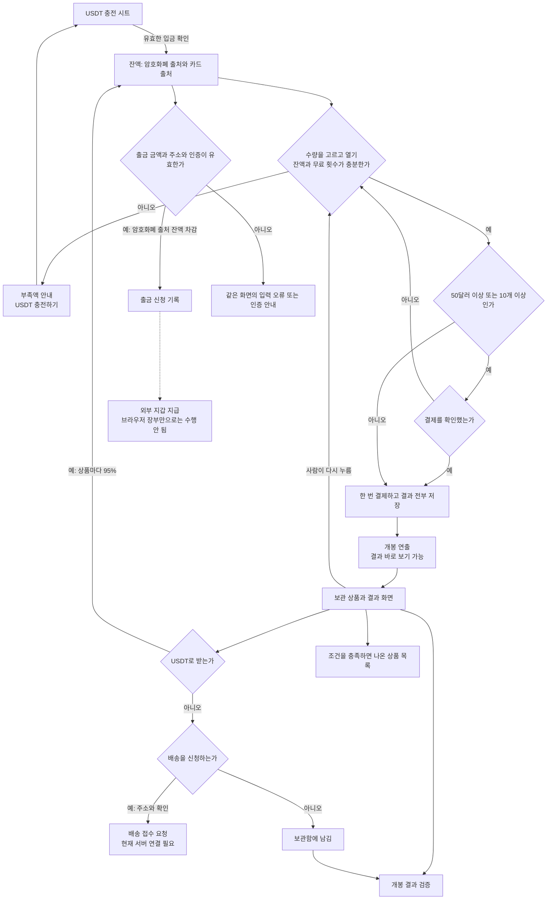

# HYPEDROP의 흐름을 VOILA에 녹이는 설계

작성일: 2026-10-12. 분석과 제안만 작성했다. 앱 코드, 문구 파일, 상품 자료는 수정하지 않았다.

## 0. 판단과 근거의 범위

핵심 제안은 실물을 받은 자리에서 `USDT로 받기`를 주 단추로 만들고, 전역 잔액 창과 잔액 부족 안내와 보관함과 출금에서도 같은 기능을 연결하는 것이다. 배송은 결과 자리에서 바로 열 수 있는 보조 링크로 남긴다. HYPEDROP의 아이템 출금을 그대로 복제해 VOILA의 출금 대상을 바꾸지는 않는다. VOILA는 상품을 참고가의 95%로 잔액에 반영한 뒤, 그중 출금 가능한 잔액을 출금하는 구조를 유지한다.

이 글의 표기:

- **현재 확인**: 현재 연결된 라우트, 컴포넌트, 함수, 문구를 코드에서 읽은 사실이다. 브라우저를 조작해 성공을 확인했다는 뜻은 아니다.
- **문서 근거**: 파운더 결정 또는 HYPEDROP 영상 분석 문서의 관찰이다. HYPEDROP 원본 영상을 이번에 다시 보지는 않았다.
- **제안**: 앞으로 만들거나 고칠 화면과 동작이다. 구현 완료를 뜻하지 않는다.
- **한계**: 서버 응답, 지급 완료, 실제 상품 가격처럼 현재 저장소만으로 확정할 수 없는 것이다.

판단 기준은 `DESIGN.md:3,9-20,24-70,81,95-106`이다. `opening/STATE.md:5-6,57-58`의 개봉 금지 사항, `catalog/BOX_PLAN.md:61-101`의 새 카탈로그 결정을 함께 적용했다. `qa/PROGRESS.md:8-21`에는 옛 상태가 남아 있으므로 현재 화면의 근거는 라우트에서 시작해 코드를 추적했다. `CLAUDE.md:15-20`이 남긴 자금 출처와 이용 기준은 유지하고, 옛 화면 규범은 설계 근거로 쓰지 않았다.

확률을 타일 옆에 적지 않는 조건은 이번 요청을 따른다. `DESIGN.md:86`의 사진 없는 행에 확률을 적는 오래된 설명과 달리, 현재 코드는 타일과 일반 구성품 행에서 확률을 빼고 별도 확률표와 상품 시트에 모았다. 그 이유도 `web/components/box/BoxScreen.tsx:228-229`에 명시돼 있다.

현재 화면의 한국어는 `web/messages/ko.json`만 읽어서는 확인할 수 없다. `web/i18n/request.ts:11-12`가 새 화면 문구인 `web/messages/v.ko.json`을 `v` 아래 합친다. 아래의 문구 줄 번호는 특별한 표시가 없으면 `v.ko.json`이다. 향후 구현 시 새 문구도 `v.ko.json`, `v.en.json`, `v.zh.json` 세 벌에 같은 뜻으로 반영해야 한다. 이번에는 어느 문구 파일도 고치지 않았다.

## 1. 현재 VOILA의 자산 상자와 고리

### 1-1. 자산 상자

| 상자 | 무엇이 들어 있는가 | 들어오고 나가는 길 | 근거 |
|---|---|---|---|
| 개봉에 쓸 잔액 | `cryptoBalance + cardBalance` | 충전과 USDT로 받기로 늘고, 개봉으로 줄어든다. 암호화폐 출처부터 사용한다 | `web/lib/funding.ts:43-56`, `web/stores/walletStore.ts:227-241` |
| 출금 가능한 출처의 잔액 | `cryptoBalance` | 출금 신청액을 여기서 뺀다. 카드 출처 금액은 포함하지 않는다 | `web/components/wallet/WithdrawScreen.tsx:39,88-105`, `web/lib/funding.ts:60-79` |
| 보관 상품 | 인스턴스별 상품 ID, 받은 시점 참고가, 상태, 자금 출처, 개봉 번호, 당시 확률표 | 개봉하면 `IN_STORAGE`, USDT로 받으면 `SOLD`, 배송을 신청하면 `SHIPPING_REQUESTED` | `web/stores/inventoryStore.ts:18-39,65-95`, `web/lib/opening.ts:90-107` |
| 처리 중인 출금 | 잔액에서 이미 제외한 신청액과 상태, 서버 거래 번호 | 완료, 실패, 취소를 별도로 기록한다. 실패와 취소는 한 번만 잔액에 복구한다 | `web/components/wallet/WithdrawScreen.tsx:93-105`, `web/stores/walletStore.ts:192-196` |
| 무료 개봉 횟수 | 특정 박스에서 쓸 수 있는 횟수 | 수량 중 무료 횟수를 먼저 쓰고 나머지만 결제한다. 잔액과 다른 자산이다 | `web/components/box/BoxScreen.tsx:74-78`, `web/lib/opening.ts:47,70-74,106` |

**현재 확인**: 새 카탈로그 자료를 읽기만 해 세었다. `web/lib/catalog2/generated.json`의 박스는 320개, 최저 가격은 $20, 각 박스의 자체 상품과 공통 상품 참조 합계는 100개다. 자료를 다시 만드는 명령은 실행하지 않았다. 모두 실물로 변환하는 코드는 `web/lib/catalog2/build.ts:25-34`이고, 실물 전용 확률 배정은 `web/lib/products.ts:269-324`다.

새 박스에는 USDT 결과와 터짐 게이지가 없다. 옛 박스 주소와 과거 기록은 남아 있고, 옛 박스에는 사다리와 USDT 결과가 남는다. 홈에서 옛 박스를 내리는 분기는 `web/lib/products.ts:336-345`, 두 방식의 선택은 `324-328`, 터짐을 새 박스에서 적립하지 않는 분기는 `web/lib/opening.ts:79-105`다. 따라서 사이트 전체에 USDT 결과가 하나도 없다고 쓰면 틀린다.

### 1-2. 현재 고리

아래 화살표는 코드상 연결이다. 서버가 필요한 화살표가 실제 지급까지 작동한다는 뜻은 아니다.

고리는 충전, 개봉, 상품 처리, 다시 개봉의 네 동작이다. 출금과 배송은 고리에서 나오는 서로 다른 길이다. 후기 작성은 결과를 받기 위한 조건이 아니다. HYPEDROP처럼 보유 상품을 다음 개봉의 재원으로 삼는 계산은 이미 있지만, 그 계산을 꺼내는 위치가 아직 배송보다 멀다.

### 1-3. 충전의 갈림길

| 갈림길 | 예 | 아니오 | 실제 문구와 근거 |
|---|---|---|---|
| 어디서나 충전에 접근하는가 | 상단 `잔액 {amount}`를 누르면 지갑으로 간다. 지갑의 `USDT 충전하기`가 시트를 연다 | 박스 탐색을 계속한다 | `web/components/shell/AppShell.tsx:49,62`, `web/components/wallet/WalletScreen.tsx:98-103`, 문구 `22,59` |
| 박스에서 잔액이 모자라는가 | 박스의 주 단추가 `USDT 충전하기`로 바뀌어 그 자리에서 시트를 연다 | 가격이 적힌 개봉 단추를 쓴다 | `BoxScreen.tsx:190-196`, 문구 `56-64` |
| 로그인돼 있는가 | 네트워크를 고르면 주소와 QR을 보여 준다 | `로그인하면 입금 주소가 표시됩니다.`와 `로그인` | `web/components/flow/ChargeSheet.tsx:36-58`, 문구 `161-175` |
| 주소를 받았는가 | `주소 복사`, `입금을 기다리는 중입니다.` | `주소를 받지 못했습니다.`와 `주소 다시 받기` | `ChargeSheet.tsx:47-57`, 문구 `166-175` |
| 유효한 입금이 확인됐는가 | 계정, 네트워크, 주소, 금액, 거래 식별자와 확인 수를 검사해 한 번 반영하고 시트를 닫는다 | 대기 또는 확인 수를 표시한다. 조회 실패도 지금 코드는 대기로 돌아간다 | `web/lib/useUsdtDeposit.ts:45-72`, `ChargeSheet.tsx:27-28,54` |
| 충전 시트를 닫았는가 | 원래 박스의 수량과 화면은 남지만 이 훅의 입금 조회는 중단된다 | 시트가 열린 동안 계속 조회한다 | `useUsdtDeposit.ts:46,71-72`. HYPEDROP 영상의 창을 떠나도 입금 반영되는 모습과 같은 보장은 없다 |

입금 선택지는 USDT의 TRC-20, BEP-20, ERC-20이다. 각각 확인 수 12, 최소 1 USDT다. 카드와 Google Pay 선택은 현재 새 충전 시트에 없다. 근거는 `web/lib/depositAddress.ts:22-28`, `ChargeSheet.tsx:45`다. 입금 주소나 실제 영수증은 이번에 조회하지 않았다.

### 1-4. 박스 선택과 개봉의 갈림길

| 갈림길 | 예 | 아니오 | 실제 문구와 근거 |
|---|---|---|---|
| 박스를 골랐는가 | `/box/[slug]`에서 `1회 {price}, 최고 상품가 {top}`를 읽는다 | 홈의 박스 목록과 상품 검색을 본다 | `BoxScreen.tsx:163`, `web/app/[locale]/page.tsx:8`, 문구 `31-35,94` |
| 구성품을 보는가 | 사진, 이름, 참고가를 본다. 상품을 누르면 확률과 USDT 수령액을 보는 시트가 열린다 | 수량과 개봉 단추로 간다 | `BoxScreen.tsx:201-225,267-278` |
| 확률을 보는가 | 아래 `확률 요약`, 구간별 확률, 접힌 `상품별 확률 보기`를 연다 | 구성품 타일에는 확률 숫자가 없다 | `BoxScreen.tsx:228-257`, 문구 `65,102-106` |
| 수량을 바꿨는가 | 1개, 5개, 10개, 50개, 100개 중 하나를 즉시 선택하고 총액을 다시 계산한다 | 1개가 기본이다. 선택만으로 결제되지 않는다 | `web/lib/autoplay.ts:13`, `BoxScreen.tsx:61,74-78,191` |
| 무료 횟수가 있는가 | 무료 횟수부터 소진한다. 전부 무료면 `무료 언박싱`, 일부 무료면 남은 개수 값만 낸다 | 선택 수량 전부 값을 낸다 | `BoxScreen.tsx:74-78,189,196`, 문구 `99-100` |
| 로그인됐는가 | 잔액을 비교한다 | `로그인하고 언박싱`을 누른다. 자동 구매를 실행하지 않는다 | `BoxScreen.tsx:192-196`, 문구 `57,78` |
| 잔액이 충분한가 | `$20 언박싱` 같은 가격 포함 단추로 결제한다 | `잔액 {balance}. {missing} 더 필요합니다.`와 충전 단추만 나온다. 보유 상품으로 채우는 링크는 없다 | `BoxScreen.tsx:190-196`, 문구 `56,58-59` |
| 총액이 $50 이상이거나 수량이 10개 이상인가 | `{amount} 결제`, `잔액에서 결제하고 바로 엽니다.` 확인창을 거친다 | 첫 개봉 입력으로 결제한다 | `BoxScreen.tsx:41-43,147-153,302`, 문구 `62-63` |
| 구매가 끝났는가 | 선택 수량의 결과를 먼저 계산하고 한 번 차감하며 보관함에 전부 기록한다 | 실패하면 지갑과 보관함을 함께 복구하고 `열지 못했습니다. 잔액은 그대로입니다.` | `web/lib/opening.ts:53-113`, `BoxScreen.tsx:141-145`, 문구 `64` |
| 연출을 끝까지 보는가 | 한 개는 기본 840ms 뒤 결과, 그 뒤 350ms 입력 보호. 짧게 보기는 450ms 뒤 결과 | `결과 바로 보기` 또는 움직임 줄이기 설정으로 건너뛴다. 결과는 다시 뽑지 않는다 | `web/lib/openingFlow.ts:62-71`, `web/components/box/Opening.tsx:111-136,227-229`, 문구 `447` |
| 여러 개를 열었는가 | `Reveal`이 같은 상자 연출 840ms 후 결과 목록을 표시한다 | `Opening`의 단일 결과 화면이다 | `BoxScreen.tsx:303-304`, `web/components/box/Reveal.tsx:29,72-80` |
| 보지 못한 개봉이 있는가 | `결과 보기`로 이미 저장된 결과를 복구한다 | 새 구매를 시작할 수 있다 | `BoxScreen.tsx:103-125,194`, 문구 `477-478` |

한 개의 설정에는 `소리와 진동`, `짧게 보기`, `상품을 자동으로 USDT로 받기`가 있다. 자동 받기는 기본 끔이고 사용자가 확인해 켠 경우만 작동한다. 실제 USDT 수령액 기준 20배 이상은 제외한다. 다음 박스를 자동 결제하는 기능과는 다르다. 현재 여러 개 결과의 `Reveal`에는 이 자동 받기와 짧게 보기 설정의 적용이 연결돼 있지 않다. 근거: `Opening.tsx:79-87,150-155,277-298`, `web/lib/openingFlow.ts:77-79`, `Reveal.tsx:29,72-80,111-128`.

### 1-5. 결과와 보관함의 갈림길

| 갈림길 | 예 | 아니오 | 실제 문구와 근거 |
|---|---|---|---|
| 단일 실물을 아직 보관 중인가 | 결과 사진과 이름, `참고가 {amount}`, `보관함에 넣었습니다`, `받는 방법 선택`이 보인다 | 이미 USDT로 받았거나 배송 신청했다면 다음 행동으로 바뀐다 | `Opening.tsx:202-220,238-248`, 문구 `458,487-490` |
| `받는 방법 선택`을 눌렀는가 | `배송 받기`와 `{amount}로 받기`를 나란히 고르고, 아래 단추를 다시 누른다. 지난 선택을 기억한다 | 상품은 보관함에 남는다 | `Opening.tsx:178-182,256-269`, 문구 `459-465` |
| USDT로 받기를 확정했는가 | 받은 금액과 이번 개봉의 잔액 변화를 표시한다. `한 번 더 언박싱 {amount}`와 검증이 열린다 | 배송 정보를 입력하거나 닫는다 | `Opening.tsx:139-147,163-177,202-207,238-248`, 문구 `122,448-456` |
| USDT로 받기가 실패 또는 대기인가 | 같은 자리의 `다시 시도, {amount}로 받기` 또는 `다시 확인` | 성공한 것만 받은 금액으로 표시한다 | `Opening.tsx:232-247`, 문구 `455-457,492` |
| 여러 개 결과에 받을 상품이 남았는가 | `받을 상품 받기 (남은 {n}개)`가 첫 미처리 상품 시트를 연다. 행을 직접 고를 수도 있다 | `한 번 더 언박싱 {amount}` 또는 닫기 | `Reveal.tsx:207-245`, 문구 `113-114,122,496` |
| 여러 결과에서 실물 하나를 골랐는가 | 주 단추는 `배송 받기`, 보조는 `USDT로 받기 ({amount})`와 `개봉 결과 검증`이다. USDT는 확인창을 한 번 더 거친다 | 결과 목록에 남는다 | `Reveal.tsx:124-128,239-251`, 문구 `119-128` |
| 결과 처리 후 다시 여는가 | 남은 잔액이 충분하면 사람이 단추를 누르고 동일 구매 검사와 큰 금액 확인을 다시 거친다 | 상품과 잔액을 그대로 둔다 | `BoxScreen.tsx:147-153,303-304`, `Opening.tsx:176-177,240` |
| 다음 개봉 잔액이 모자라는가 | 단일 결과는 `박스로 돌아가기`, 여러 결과에서 받을 것이 없으면 `닫기`다 | 바로 다시 여는 단추가 있다 | `Opening.tsx:240`, `Reveal.tsx:119,230-231`. 결과 자리에서 충전과 상품 받기를 함께 풀지는 못한다 |
| 보관함 상품을 눌렀는가 | 상태와 참고가, 받은 날을 보고 배송, USDT로 받기, 검증, 조건부 후기 쓰기를 할 수 있다 | `보관 중`, `배송`, `받은 것`으로 목록을 고른다 | `web/components/inventory/InventoryScreen.tsx:95-114,118-150`, 문구 `215-254` |
| 보관함의 실물을 USDT로 받는가 | 실물 상세의 보조 링크와 확인창으로 받는다. 받은 것 목록으로 이동한다 | 주 단추인 배송을 신청하거나 닫아 보관한다 | `InventoryScreen.tsx:69-73,133-150` |
| 보관함이 비었는가 | `보관 중인 상품이 없습니다.`와 `박스 보기` | 받은 시점과 상태에 따라 정렬한 30개 단위 목록 | `InventoryScreen.tsx:27,64-65,95-114`, 문구 `224-230` |

보관함의 오른쪽 금액은 보관 중일 때 95% 수령액, USDT로 받은 뒤에는 실제 받은 금액, 배송 상태에서는 참고가다. `InventoryScreen.tsx:106-107`의 분기다. 모든 행의 금액이 출금 가능액이라는 뜻은 아니다. 현재 설명 문구 `v.ko.json:217`은 이 차이를 충분히 구분하지 않는다.

USDT로 받기의 계산은 `web/lib/types.ts:133`의 0.95, `web/stores/inventoryStore.ts:74-94`의 상품별 소수 둘째 자리 반올림, `web/lib/claim.ts:18-25`의 잔액 가산과 내역 기록이다. 출금 수수료는 여기서 떼지 않는다. 참고가 $100이면 $95가 잔액으로 들어온다. 카드 출처 상품이면 그 $95가 카드 출처 잔액으로 돌아가므로 외부 지갑으로 출금할 수 없다.

보관 기한 문구와 옛 규정이 있어도 현재 `inventoryStore.ts:64`의 `sweepExpired`는 아무것도 하지 않는다. 30일 뒤 자동 지급이 현재 작동한다고 적을 근거는 없다.

### 1-6. 배송과 출금의 갈림길

| 갈림길 | 예 | 아니오 | 실제 문구와 근거 |
|---|---|---|---|
| 배송을 고르는가 | 같은 결과 자리 또는 보관함에서 `배송 받기` 시트를 연다 | 보관하거나 USDT로 받는다 | `Opening.tsx:272`, `Reveal.tsx:250`, `InventoryScreen.tsx:147` |
| 주소가 유효한가 | 나라, 받는 사람, 전화, 우편번호, 상세 주소와 필요한 통관 정보를 넣고 `배송 신청`을 누른다 | 해당 칸 아래 오류가 나온다 | `web/components/flow/ShipSheet.tsx:42-79`, 문구 `256-278` |
| 배송 신청을 확인했는가 | 주소 확인창 뒤 서비스에 접수를 요청한다 | 시트로 돌아간다 | `ShipSheet.tsx:51-57,79`, `web/lib/claim.ts:32-45` |
| 서비스가 접수를 받았는가 | 상품 상태와 지갑을 반환값으로 반영한다 | `배송 신청을 접수하지 못했습니다. 상품은 보관함에 그대로 있습니다.` | `claim.ts:35-45`, 문구 `278`. 브라우저 계정 경로에는 배송 접수 구현이 없고 마지막에 unavailable을 던진다: `web/lib/browserAccount.ts:339` |
| 출고 전 배송 신청을 취소하는가 | 확인 후 보관 중으로 돌아오며 낸 배송비가 있다면 원래 출처로 복구한다 | 배송 상태를 유지한다. 이미 출고된 상품은 취소하지 못한다 | `InventoryScreen.tsx:74-79,135-151`, `claim.ts:52-71` |
| 운송장이 있는가 | `배송 조회`로 외부 택배사 페이지를 연다 | `운송장 번호는 출고되면 표시됩니다.` | `InventoryScreen.tsx:131,136`, 문구 `244-245` |
| 출금하려는가 | 지갑의 `출금` 링크로 `/wallet/withdraw`에 간다 | 충전 또는 내역을 본다 | `WalletScreen.tsx:102-103` |
| 인증 앱이 연결됐는가 | 출금 입력으로 간다 | 같은 화면에서 `인증 앱 연결하기`, 또는 `이메일 인증으로 출금 (72시간 뒤 전송)` | `WithdrawScreen.tsx:153-164`, 문구 `365-368` |
| 금액과 네트워크와 주소가 유효한가 | `출금 확인`에서 전체 주소, 신청액, 수수료, 받을 금액을 보여 준다 | 최소액, 잔액 초과, 주소 오류를 같은 화면에 쓴다 | `WithdrawScreen.tsx:68-84,166-177,212-234`, 문구 `350-375` |
| 인증이 통과했는가 | API에 신청하고 반환받은 상태를 기록한 뒤 crypto 잔액에서 신청액을 뺀다 | OTP 오류를 표시한다. 세 번 틀리면 이메일 경로로 간다 | `WithdrawScreen.tsx:88-140` |
| 외부 지갑 지급까지 됐는가 | 서비스가 완료와 거래 해시를 주면 내역에서 확인한다 | 신청 또는 대기 상태만 표시한다. `출금을 신청했습니다`는 지급 완료가 아니다 | `WithdrawScreen.tsx:200-208`, `WalletScreen.tsx:43-61,124-140`, 문구 `380-384` |

배송비는 현재 13개 지원 국가에서 $0이다. `web/lib/shipping.ts:7-19`의 무료 플래그에 따른다. 이 설계에서도 회사 부담과 상품별 신청을 유지한다. 카탈로그 결정에 어긋나는 고객 배송비나 묶음 배송을 새로 넣지 않는다.

**출금의 대상은 잔액이다. 아이템이 아니다.** 입력값에 상품 ID가 없고 금액, 주소, 네트워크만 있다. 최소 신청액은 $20, TRC-20 수수료는 $1, BEP-20은 $0.50이다. 수수료는 신청액 안에서 뺀다. 전액 출금은 잔액 전부가 신청액이다. 근거: `web/lib/withdrawal.ts:19-26,56-73`, `WithdrawScreen.tsx:28,93-103`.

서버 없는 현재 환경에서는 브라우저 출금 경로가 PENDING 또는 72시간 대기 기록을 만들 수 있지만 체인 송금은 하지 않는다. 대기가 끝나도 PENDING으로만 바뀐다. `web/lib/account.ts:109-111`, `web/lib/browserAccount.ts:321-339`에 그 한계가 있다. 충전 주소와 체인 송금이 실제로 연결됐다고 이 글에서 가정하지 않는다.

**현재 발견한 조건 누락**: 유효한 돈 규범에는 이용 기준이 있고 `web/lib/rollover.ts:16-30,57-65`에 계산 함수가 남아 있지만, 현재 `WithdrawScreen.tsx:68-90`과 `web/lib/withdrawal.ts:60-69`는 주소, 최소액, 잔액만 검사한다. 브라우저 `/withdraw`도 `browserAccount.ts:321-327`에서 이 기준을 검사하지 않는다. 따라서 지금 화면이 모든 출금 조건을 지킨다고 단정할 수 없다. 향후 출금 연결을 늘리기 전에 기존 기준을 서버와 화면에 일관되게 적용해야 한다. 새 이용 기준을 만들자는 제안은 아니다.

### 1-7. 검증, 나온 상품, 후기의 갈림길

| 갈림길 | 예 | 아니오 | 실제 문구와 근거 |
|---|---|---|---|
| 결과나 보관함에서 검증을 누르는가 | `개봉 결과 검증` 시트가 잠근 값, 공개된 값, 내 기기 값, 회차와 계산 번호를 보여 준다 | 결과 처리 화면에 남는다 | `web/components/flow/VerifySheet.tsx:47-60`, 문구 `177-191` |
| 당시 확률표가 있는가 | 해시, 번호, 상품을 함께 대조한다 | 번호까지만 확인했다는 부분 검증 문구를 쓴다 | `web/components/fairness/verifyRecord.ts:15-27`, 문구 `191` |
| `/verify`에서 내 기록을 고르는가 | 저장된 기록과 당시 확률표를 쓴다 | 아래 직접 입력 계산기로 계산할 수 있다 | `web/components/verify/VerifyScreen.tsx:71-112` |
| 직접 입력한 값에 해시가 있는가 | 공개된 값의 해시와 비교한다 | 번호 계산만 한다. 잠근 값은 선택 항목이다 | `VerifyScreen.tsx:54-63,97,105-111` |
| 직접 입력 결과의 상품을 찾는가 | 현재 박스 확률표로 찾고 현재 표라는 설명을 쓴다 | 기록 검증으로 돌아가야 당시 표를 비교할 수 있다 | `VerifyScreen.tsx:59-62,111`, 문구 `204` |
| 후기 없이 좋은 결과가 나왔는가 | `/wins`가 보관함에서 현재 박스 가격의 두 배 이상인 비현금 상품을 최신순으로 모은다 | `아직 낸 값의 2배 이상이 나온 기록이 없습니다.` | `web/components/box/WinsScreen.tsx:20,31-47`, 문구 `544-550` |
| 나온 상품 목록에 행이 있는가 | 닉네임 앞 두 글자, 상품 사진, 이름, 금액과 배수, 박스, 시각, 검증 링크가 나온다. `이 계정에서 연 기록입니다.`가 붙는다 | 빈 화면에서는 현재 코드상 계정 범위 안내도 빠진다 | `WinsScreen.tsx:39-65` |
| 후기를 쓸 자격이 있는가 | 참고가 $100 이상이고 아직 쓰지 않은 개봉 기록에서 `후기 쓰기`가 열린다. 배송 전에도 쓸 수 있다 | 후기 단추가 없다 | `web/lib/community.ts:10-12,52-58`, `InventoryScreen.tsx:84-86,140` |
| 후기 화면을 보는가 | 별점, 글, 닉네임, 상품과 금액, 작성 시각을 본다. 상세의 내 기록에는 검증 링크가 있다 | 없는 박스에는 후기 없음 상태 | `web/components/box/BoxReviews.tsx:119-190`, `web/components/box/ReviewsScreen.tsx:26-42` |

중요한 현재 불일치 셋:

1. `/wins`는 새로 만들어야만 하는 화면이 아니다. 이미 있다. 다만 기준이 획득 당시 가격이 아니라 현재 `box.price`이고, 문구는 `낸 값`이라고 한다. 무료 개봉이나 가격 변경 때 틀린 설명이 된다. 그 기록의 검증 링크도 당시 표를 전달하지 않고 현재 표의 수동 계산기로 간다. `WinsScreen.tsx:32-37`, `VerifyScreen.tsx:59-62`가 근거다.
2. 후기의 실제 실행 코드는 샘플을 합친다. `BoxReviews.tsx:104-114`는 일부 예시를 걸러낸 뒤 별도로 `REVIEW_SAMPLES`를 추가한다. `web/lib/reviewSamples.ts:1-4,17-45`는 실제 이용자 글이 아니라고 명시한다. 카드에는 샘플 표지가 없고 별점 합계에도 들어간다. 새 320개 박스와 샘플의 옛 slug가 일치하지 않아 새 박스는 대개 비지만, 전체 후기와 옛 박스에서는 샘플이 보일 수 있다. 홈 카드도 `web/components/box/BoxList.tsx:117-126`에서 샘플 기반 `ratingSummary`를 직접 쓰므로 상세 후기와 집계 경로가 다르다. 다른 사람의 실제 결과가 있다는 근거로 쓸 수 없다.
3. 검증의 `서버가 값을 정하고 그 해시만 보여 줍니다`라는 현재 문구는 서버 없는 구현과 맞지 않는다. `web/stores/fairStore.ts:40-66`은 브라우저가 원문 시드도 만들고 저장한다. 같은 시드는 여러 회차에 쓰이고 결과에 원문이 공개된다. 지금 보장하는 것은 저장된 입력을 다시 계산하는 일이지, 외부 기관이나 블록체인이 개봉 전에 잠갔음을 보증하는 일이 아니다. 관련 문구는 `v.ko.json:207-212`다.

## 2. HYPEDROP 장치별 대조

판정의 `이미 있다`는 현재 연결된 화면에 같은 목적의 기능이 있다는 뜻이다. 실서비스 완료 보장을 뜻하지 않는다. `없다`는 현재 라우트의 흐름에 없다는 뜻이며, 버려진 파일이나 미사용 문구가 없다는 뜻이 아니다.

| HYPEDROP의 장치와 문서 근거 | VOILA 판정 | 현재 근거 | 녹이는 결정 |
|---|---|---|---|
| 잔액과 보유 아이템을 분리, 7-9행 | 이미 있다 | `inventoryStore.ts:18-39`, `funding.ts:13-27` | 유지 |
| 어느 화면에서나 충전 창, 68행 | 반쯤 있다 | `AppShell.tsx:49,62`, `WalletScreen.tsx:102` | 잔액 창을 전역으로 열어 같은 자리 복귀 |
| 카드, Google Pay, 기프트 카드, 여러 코인, 70-74행 | 반쯤 있다 | `ChargeSheet.tsx:45`, `depositAddress.ts:22-28` | USDT 네트워크만 유지. 결제 수단 확대는 제외 |
| 충전 실패 후 같은 창 재시도, 71행 | 이미 있다 | `ChargeSheet.tsx:52-56` | 유지하고 입금 조회 실패를 대기와 구분 |
| 다른 화면으로 가도 입금 반영, 72행 | 반쯤 있다 | `useUsdtDeposit.ts:46,71-72` | 조회를 계정 단위로 유지 |
| 프로모션 코드 5%, 69행 | 없다 | `ChargeSheet.tsx:44-58` | 보너스 경제 변경이라 제외 |
| 박스와 낱개 상품의 DEALS 진입, 80행 | 반쯤 있다 | `web/components/box/BoxList.tsx:62-95`, `BoxScreen.tsx:267-298` | 상품 탐색과 박스 비교는 유지, DEALS는 제외 |
| 구성품과 확률 공개, 81행 | 이미 있다 | `BoxScreen.tsx:228-257,272-276` | 유지 |
| 타일 옆 확률과 숨기기, 81행 | 없다 | `BoxScreen.tsx:209,218,228-229,315` | 그대로 복제하지 않음. 별도 표와 상품 시트 |
| FREE TRY, 82행 | 없다 | `BoxScreen.tsx:189-196`, `opening.ts:47,90-106` | 지급되는 무료 횟수와 구분. 체험 추가는 후순위 제외 |
| 수량 선택과 결제 전 총액, 83행 | 이미 있다 | `autoplay.ts:13`, `BoxScreen.tsx:77,191-196` | 유지 |
| 부족할 때 TOP-UP과 SELL ITEMS, 84행 | 반쯤 있다 | `BoxScreen.tsx:190-196` | `USDT로 받기`를 같은 자리에 추가 |
| Loop와 STOP LOOP, 85-86행 | 없다 | `BoxScreen.tsx:147-153,303-304`, `openingFlow.ts:126-130` | 다음 열기 자동 결제 금지로 제외 |
| SPEEDRUN과 소리, 88행 | 반쯤 있다 | `Opening.tsx:277-298`, `Reveal.tsx:29,72-80` | 단일의 짧게 보기와 소리를 여러 개에도 같은 의미로 적용 |
| ADD TO FAVORITE, 88행 | 없다 | `BoxScreen.tsx:160-305` | 이번 범위에서 제외 |
| 결과가 별도 수령 없이 보관됨, 92행 | 이미 있다 | `opening.ts:90-108` | 유지 |
| 결과 바로 아래 SELL, 두 번째 입력으로 확정, 96-97행 | 반쯤 있다 | `Opening.tsx:247,256-269`, `Reveal.tsx:127,251` | 95%를 보여 주는 주 단추와 확인 한 번 |
| 결과 여러 개를 묶어 SELL, 97행 | 반쯤 있다 | `claim.ts:18`, `Reveal.tsx:230-251` | 계산은 배열을 받지만 UI는 하나씩. 선택 묶음 받기 추가 |
| UPGRADE, 배수, 실패 시 상품 소멸, 재시도, 98-104행 | 없다 | 현재 결과 행동 `Opening.tsx:237-248`, `Reveal.tsx:124-128` | 새 확률과 소멸 계산이므로 제외 |
| 출금 창에서 아이템 선택, 108-119행 | 없다 | `WithdrawScreen.tsx:28,212-234` | 출금 창 안에 USDT로 받기를 연결하되 출금은 잔액 기준 유지 |
| 선택 변경과 주소 확인과 요청 상태, 113-117행 | 반쯤 있다 | `WithdrawScreen.tsx:166-208` | 금액 수정은 있음. 상품 선택 경로를 추가 |
| 아이템 판매 100%, 출금 견적 약 2%, 177-181행 | 없다 | `types.ts:133`, `withdrawal.ts:19-26,56-73` | 95%와 고정 네트워크 수수료 유지 |
| 출금 확정 카운트다운, 116행 | 없다 | `WithdrawScreen.tsx:166-198` | 재촉 타이머는 제외. 인증 코드 만료는 상태로만 |
| 출금은 가깝고 배송은 별도 화면, 224-240행 | 반쯤 있다 | `Opening.tsx:256-272`, `InventoryScreen.tsx:133-140` | USDT를 우선하되 배송은 결과 자리의 링크로 유지 |
| CART의 검색, 정렬, 전체 선택, 상태, 132행 | 반쯤 있다 | `InventoryScreen.tsx:95-114` | 상태 유지, USDT 대상 선택 추가. 나머지 검색 도구는 후순위 |
| ORDER 자물쇠, 132행 | 없다 | `InventoryScreen.tsx:133`, `ShipSheet.tsx:51-79` | 배송을 막는 장치로 복제하지 않음 |
| STASH의 현금과 아이템 넣기, 꺼내기, 잠금, 133행 | 없다 | `inventoryStore.ts:43-53` | 현재 보관함과 다른 자산 계층이므로 제외 |
| KYC 등급과 외부 인증, 129-130행 | 반쯤 있다 | `WithdrawScreen.tsx:153-164` | VOILA의 OTP와 이메일은 KYC가 아니다. 기존 인증 유지, 신분 인증 신설 제외 |
| 약관 업데이트 창, 131행 | 없다 | `v.ko.json:152`, `AppShell.tsx:41-64` | 가입 동의와 별개. 반복 창 복제 제외 |
| 거래, 개봉, 배송, 입출금 기록, 135행 | 이미 있다 | `WalletScreen.tsx:105-140`, `InventoryScreen.tsx:95-139`, `VerifyScreen.tsx:71-89` | 기록 간 상품과 거래 연결 보완 |
| 시드 변경, 현재와 미래 해시, 공개, 136행 | 반쯤 있다 | `fairStore.ts:40-59`, `VerifyScreen.tsx:93-123` | 계산은 있음. 사전 고정 증거와 체인 연결은 별도 설계 |
| 개인 통계와 통계 숨김, 137행 | 반쯤 있다 | `WinsScreen.tsx:31-65`, `web/components/account/AccountScreen.tsx:49-70` | 개인 좋은 결과는 있음. 순위와 운 점수는 제외 |
| 추천 최대 10%와 친구 5%, 138행 | 없다 | 현재 메뉴 `AppShell.tsx:22-29`, 충전 `ChargeSheet.tsx:44-58` | 보상 계산 변경이라 제외 |
| DEALS의 값과 확률 선택, 139행 | 없다 | 현재 박스 구매 `BoxScreen.tsx:128-153` | 별도 게임 신설 제외 |
| BATTLES, BLACK MARKET, RACE, FREE DROP, 141행 | 없다 | `AppShell.tsx:22-29` | 영상에서 내부도 미확인. 무료 지급 횟수와 같은 것으로 치지 않음 |
| 7.5초 릴과 멈추기 직전 주변 고가 카드, 188-204행 | 없다 | `Opening.tsx:197-220`, `openingFlow.ts:62-71` | 가짜 근접 실패와 긴장 감속은 제외. 현재 상자 연출 유지 |
| LIVE DROPS, 215행 | 반쯤 있다 | `WinsScreen.tsx:31-65`, `AppShell.tsx:41-64` | 내 결과 목록만 있음. 실시간 타인 목록은 서버 증거 뒤에 |
| RACE 카운트다운, 216행 | 없다 | `AppShell.tsx:41-64` | 재촉 금지로 제외 |
| XP와 LEVEL과 BUY XP, 실패 보상 XP, 217행 | 없다 | `Opening.tsx:202-248`, `web/components/account/AccountScreen.tsx:49-71` | 낮은 결과의 손실을 흐릴 위험과 새 경제 때문에 제외 |
| BEST UNBOXINGS와 RECENTLY UNBOXED, 218행 | 반쯤 있다 | `WinsScreen.tsx:31-38`, `VerifyScreen.tsx:50,78-88` | 최신 조건 충족 결과와 전체 내 기록을 구분. 최고가만 반복하지 않음 |
| 피드백, 도움, 정책, 공정성 링크, 140행 | 반쯤 있다 | `web/components/shell/AppFooter.tsx:32-57`, `AppShell.tsx:22-29` | 도움과 정책과 검증은 있음. 전용 피드백 접수는 확인되지 않아 추가 대상으로 삼지 않음 |

위 표에서 파일명만 적힌 것은 각각 `web/components/box`, `web/components/wallet`, `web/components/flow`, `web/components/shell`, `web/stores`, `web/lib`의 앞 절에 명시한 같은 파일이다. HYPEDROP의 초록 SELL 단추, 여러 동시 주 단추, 성공 색 테두리는 기능의 필수 조건이 아니다. `DESIGN.md:26,32-44`에 따라 흰 주 단추 하나와 밑줄 링크로 바꾼다.

## 3. 녹이지 않는 장치와 대신 이루는 방법

| 가져오지 않을 것 | 이유 | 같은 목적을 이루는 제안 |
|---|---|---|
| 지어낸 타인 당첨과 샘플 후기의 실제 활동 표시 | `DESIGN.md:14`, `CLAUDE.md:20`과 충돌한다. HYPEDROP 문서도 LIVE DROPS가 실제인지 확인하지 못했다 | 현재 계정의 실제 생성 기록만 범위를 밝히고 표시한다. 공개 자료가 없으면 빈 목록이다 |
| 고가 상품이 바로 옆을 지나가며 놓친 듯한 연출 | `DESIGN.md:14,78`, `opening/STATE.md:6`과 충돌한다. 경쟁 영상이 의도한 근접 실패였다고 단정하지도 않는다 | 이미 뽑힌 상품만 공개하는 상자 연출과 실제 참고가, 실제 받을 금액을 쓴다 |
| 낮은 결과의 고등급 빛, 승급 반전, 손실을 보상처럼 보이는 XP | `opening/STATE.md:6`과 충돌하거나 손실 판단을 흐린다 | `receivedValue` 기준의 현재 톤을 유지하고 쓴 금액, 받은 금액, 잔액 변화를 함께 보여 준다 |
| Loop로 다음 개봉 자동 결제 | `opening/STATE.md:6`의 명시 금지다 | 같은 수량과 박스를 기억하고 가격이 적힌 단추를 사람이 매번 누른다 |
| RACE 종료와 판매 확정 재촉 타이머 | `DESIGN.md:14`와 충돌한다 | 선택은 유지한다. 실제 인증 만료와 출금 보안 대기는 글로 상태와 해제 시각을 설명한다 |
| 구성품 타일 옆 확률, 확률을 감추는 토글 | 이번 지시와 현재 분리 배치에 어긋난다 | 열기 근처 `구성품과 확률` 링크, 별도 확률 요약, 상품별 표와 상품 시트에서 같은 데이터 공개 |
| 배송을 없애거나 자물쇠로 잠그기 | `DESIGN.md:12`의 결과 자리에서 받기와 실물 지급 전제에 어긋난다 | 결과의 보조 `배송 받기` 링크를 유지한다. USDT만 주 단추로 가까이 둔다 |
| HYPEDROP의 100% 판매, 2% 출금 수수료, 업그레이드 90% 구조 | VOILA의 95%, 기존 수수료와 추첨 계산을 바꾸게 된다 | 접근성만 가져온다. 금액과 확률은 기존 함수 그대로다 |
| 출금 완료처럼 보이는 성공 문구와 체인 검증 배지 | 현재 브라우저 기록에는 지급도 체인 사전 기록도 없다 | `출금을 신청했습니다`, `블록체인 기록 없음`처럼 확인한 범위만 말한다 |

무료 체험, 즐겨찾기, 개인 통계는 그 자체가 금지는 아니다. 다만 이번 핵심인 상품 받기와 신뢰에 앞서 새 화면과 상태를 늘리므로 채택 범위에서 뺀다. 실제로 지급되는 가입 무료 개봉은 유지한다. 무료 체험을 나중에 도입해도 실제 보관 상품이나 나온 상품 목록에 넣어서는 안 된다.

## 4. 공통 설계 계약

### 4-1. 화면과 문구

이하 전부 제안이다. 바탕과 카드, 글꼴, 버튼은 `DESIGN.md:29-55`의 토큰과 규격 그대로다. 모바일은 아래 시트와 아래쪽 높이 52px 주 단추, PC는 가운데 창 또는 좁은 결정 열이다. 선택 목록은 카드 여러 개가 아니라 한 카드 안의 행이다. 주 단추 하나, 보조 링크 최대 둘을 지킨다. 시트가 열리면 뒤 화면의 단추는 입력과 포커스에서 제외한다.

금액은 기본 달러 표시이고 USDT는 자산과 행동 이름에 남긴다. 예를 들어 `USDT로 받기 ($95)`다. `판매`, `환전`, `캐시백`으로 이름을 바꾸지 않는다. 상품 가격은 검증된 소매 정가 자료가 없는 현재 `참고가`라고 적는다. 빈 목록을 채우기 위해 닉네임, 후기, 상품 결과, 시간을 만들지 않는다.

공통 상태는 각 화면 안에서 처리한다:

| 상태 | 표시와 행동 |
|---|---|
| 최초 불러오기 | 고정된 행 높이의 빈 뼈대와 `불러오는 중`, 이전 계정의 값은 숨김 |
| 처리 중 | 누른 즉시 반응하고 0.3초를 넘으면 단추 자리에 `확인 중`, 중복 제출 막기 |
| 대상 없음 | 기능별 빈 문구와 가능한 다음 행동 하나. 0을 성공처럼 표시하지 않음 |
| 실패 | 현재 화면의 한 줄과 재시도 단추. 응답을 모르면 실패와 완료 중 하나로 추측하지 않고 `처리 상태를 확인하는 중입니다.` |
| 오프라인 | `인터넷 연결이 끊겼습니다. 연결되면 처리 상태를 확인합니다.` 원래 선택과 입력 유지, 미확인 요청 재전송 금지 |
| 세션 만료 | `다시 로그인하면 처리 상태를 확인합니다.` 재로그인 후 같은 계정의 처리 상태부터 조회 |
| 잔액 부족 | 무엇에 필요한 얼마가 모자라는지 표시. USDT로 받기 자체에는 잔액을 요구하지 않음 |
| 기록 없음 또는 잘못된 주소 | `기록을 찾을 수 없습니다.`와 `내 개봉 기록` 링크. 다른 기록으로 자동 대체하지 않음 |

### 4-2. 돈 계산을 고정하는 계약

모든 아래 설계에서 새 수수료와 보너스는 $0이다. 개봉 가격, 무료 횟수, 확률, 출금 최소액, 출처 분리는 바꾸지 않는다.

| 계산 | 유지할 식과 예 |
|---|---|
| 상품 한 개를 USDT로 받기 | 획득 시 고정한 참고가 V에 대해 `+(V * 0.95).toFixed(2)`. $100이면 $95 |
| 여러 개 받기 | 상품마다 위 식으로 계산한 값을 합친다. 합계 참고가에 0.95를 한 번 곱하는 방식으로 바꾸지 않는다 |
| 출처 배분 | 상품별 `fundingRatio`에 대해 `attributeRefunds`를 그대로 사용한다. 카드 몫을 출금 가능액에 합치지 않는다 |
| 다음 개봉 | 박스 가격 × 유료 개수. USDT로 받은 동작은 다음 구매를 실행하지 않는다 |
| 출금 | 신청액 A만 crypto 잔액에서 제외하고 외부 수령액은 A에서 네트워크 수수료를 뺀다. 최소 A는 $20 |
| 배송 | 지원 국가의 고객 배송비 $0. 회사 비용은 수익 분석에서 따로 계산하며 상품 하나씩 신청한다 |
| 기대 가치 | 문서상의 참고가 평균 99%와 전부 95%로 받을 때 94.05%를 구분한다. 실제 표시는 상품별 반올림까지 포함한 `retailReturn`, `cashReturn` 계산 결과를 쓴다 |

근거: `inventoryStore.ts:85-94`, `funding.ts:63-79`, `withdrawal.ts:19-26,56-73`, `products.ts:369-371`, `catalog/BOX_PLAN.md:84-90`. 94.05%는 한 번 열 때 그만큼 받는다는 보장이 아니다. 남는 5.95%도 배송비와 결제비용과 혜택을 뺀 순이익이 아니다.

## 5. 채택할 흐름의 구체 설계

### 5-1. 결과 자리에서 USDT로 받기

**위치와 순서**: 단일 결과의 사진과 이름 아래에 참고가와 95% 수령액을 보여 준다. 결과 아래 주 단추를 `받는 방법 선택`에서 `USDT로 받기 ($95)`로 바꾼다. 보조 링크는 `배송 받기`, `개봉 결과 검증` 둘이다. 닫으면 보관 중으로 남으므로 별도 보관 확인은 없다.

결과 제목은 `상품을 받았습니다`로 하고 이름은 카드 안에 둔다. 설명은 `참고가의 95%를 USDT로 받아 잔액에 넣을 수 있습니다.`다. 주 단추를 누르면 최종 확인 시트 하나가 열린다. 제목 `USDT로 받기`, 설명 `상품 대신 $95를 잔액으로 받고, 받은 뒤에는 배송으로 바꿀 수 없습니다.` 카드에는 상품 이름, 참고가 $100, 받을 금액 $95를 적는다. 주 단추는 `USDT로 받기 ($95)`, 보조는 `취소` 하나다. 별도의 방법 선택과 계속 단계를 없애는 것이다.

처리 성공 뒤 제목은 `$95를 잔액에 반영했습니다`다. 이번 개봉에 쓴 금액과 잔액 변화는 현재 영수증 계산을 유지한다. 그 자리 주 단추는 기존 `한 번 더 언박싱 {amount}`이고 보조는 `개봉 결과 검증`, `박스로 돌아가기`다. 새 단추에는 기존 350ms 입력 보호를 적용한다. 다른 화면에서 처리돼 있으면 실제 처리 기록을 보여 주고 다시 지급하지 않는다.

**상태**: 처리 중 `확인 중`, 상태 미확인 `처리 상태를 확인하는 중입니다.`, 확정 실패 `USDT로 받지 못했습니다. 상품은 보관함에 있습니다.`와 `다시 확인`. 상품을 못 찾으면 `상품 기록을 찾을 수 없습니다.`와 보관함 링크다. 다음 개봉 잔액 부족은 5-3으로 연결한다. 받은 금액을 먼저 올려 표시하지 않는다.

**돈**: 95%와 출처 계산은 그대로다. `settleTake`와 같은 상품 ID의 중복 처리 방식을 재사용한다. 참고가 표시를 실수령액으로 오해하지 않게 두 숫자의 라벨을 분리한다.

**테스트**: 같은 상품에서 연타, 결과 닫기, 새로고침, 두 탭, 계정 변경, 응답 유실 뒤 재조회에 지급이 한 번인지 확인한다. 이미 배송된 상품은 받을 수 없어야 한다. $20를 내고 참고가 $20를 받아 $19가 들어온 경우 증가처럼 보이면 실패다. 기존 `tests/claim.test.ts:19`, `tests/openingFlow.test.ts:15-50,118-147`에 더해 실제 단추 동선을 검사한다.

### 5-2. 여러 결과와 보관함의 선택 묶음

**위치와 순서**: 여러 결과 화면과 보관함의 `보관 중` 목록은 같은 선택 시트를 연다. 행마다 체크 영역, 사진, 상품 이름, 참고가, `USDT로 받으면 $95`를 둔다. 결과 화면에서는 방금 나온 아직 보관 중인 상품만 범위다. 보관함에서는 현재 계정의 보관 중 상품이 범위다. 아무 상품도 미리 선택하지 않는다.

선택 전 주 단추는 비활성 `상품을 선택합니다`, 선택 후에는 `USDT로 받기 (3개, $285)`다. 보조 링크는 `전체 선택`과 `박스로 돌아가기` 또는 보관함 복귀 하나다. `전체 선택`은 화면에 안 보이는 페이지까지 선택하는지 대상 수를 정확히 적고, 처리 중이거나 배송 상태인 상품은 제외한다. 고가 상품도 선택 사실과 전체 명세를 최종 확인 시트에서 볼 수 있어야 한다. USDT로 받는 확인은 5-1과 동일하다.

상품 이름을 누르면 단일 상세 시트다. 주 단추 `USDT로 받기 ($95)`, 보조 `배송 받기`, `개봉 결과 검증`이다. 상세의 후기 쓰기는 세 번째 보조로 끼우지 않고 `받은 것`의 후기 가능한 행에서 연다. 선택 목록과 상세의 결정을 같은 화면에 겹치지 않는다. 배송은 항상 상품 하나의 상세에서 신청하며 묶음 배송 단추는 만들지 않는다.

**상태**: 빈 목록 `USDT로 받을 상품이 없습니다.`. 선택 중 다른 탭이 처리했다면 `선택한 상품의 상태가 바뀌었습니다. 남은 상품과 금액을 확인합니다.`로 금액을 다시 제시한다. 일부만 완료된 요청은 완료한 상품과 남은 상품을 행으로 구분하고, 전부 성공 문구를 쓰지 않는다. 잔액이 $0이어도 받을 수 있다. 불러오기와 실패는 4-1을 따른다.

**돈**: `takeUsdt(ids)`의 상품별 반올림과 출처 배분을 유지한다. 여러 상품 동작은 계정 잠금과 요청 ID로 묶고 성공한 ID와 실제 받은 금액을 영수증으로 남겨야 한다. 기존 함수가 배열을 받는다고 두 탭과 서버 재시도까지 안전한 것은 아니다. 결과의 단일 잠금인 `web/lib/openingSettle.ts:33-51`과 같은 보호 범위를 선택 묶음에도 적용하는 구현이 필요하다.

**테스트**: 0개, 1개, 100개, 같은 상품의 서로 다른 인스턴스, 중복 ID, 배송 중 ID, 카드와 crypto 혼합, 상품별 $0.01 경계와 부분 완료를 검사한다. 각 행의 받을 금액 합계와 지급 내역 합계가 같아야 한다. `tests/funding.test.ts:32-38`, `tests/claim.test.ts:19`의 불변식을 유지하고 여러 개 결과에서 360px 폭과 큰 글자, 스크롤 끝의 확인 버튼을 검사한다.

### 5-3. 잔액 부족을 같은 자리에서 풀기

**위치와 순서**: 박스의 개봉 단추 자리와 결과의 다음 개봉 단추 자리에 같은 부족 상태를 둔다. 문구는 `잔액 $12. $8 더 필요합니다.`다. 보관 중 상품이 있으면 주 단추를 `USDT로 받기`로 하고 보조는 `USDT 충전하기`, `수량 바꾸기`다. 보관 상품을 불러오는 동안은 기존 충전 경로를 막지 않는다. 상품이 없으면 주 단추가 `USDT 충전하기`이고 보조는 `수량 바꾸기` 하나다.

상품이 있어도 받을 수 있는 금액이 부족액에 못 미칠 수 있다. 진입 전에 `보관 상품을 USDT로 받으면 최대 $5가 잔액에 들어옵니다.`라고 정확히 쓴다. 선택 시트에서 필요한 상품을 스스로 고르게 하고 자동으로 싼 상품부터 처리하지 않는다. 받은 뒤 아직 $3가 모자라면 같은 자리의 부족액만 갱신한다. 다 채워져도 다음 개봉은 실행하지 않는다. 원래 박스, 수량과 가격이 적힌 단추로 돌아온다.

결과의 5-1 화면에서는 남은 결과 상품을 USDT로 받는 행동이 우선이다. 그 처리가 끝난 후 다음 개봉이 부족할 때 이 상태를 쓴다. 이미 보관한 다른 상품도 같은 선택 시트에서 찾을 수 있다.

**상태**: 조회 실패 `보관 상품을 불러오지 못했습니다.`와 `다시 불러오기`, 충전 링크. 충전 주소 실패는 기존 `주소 다시 받기`다. 무료 횟수 변경이나 다른 탭의 지출이 있으면 현재 유료 총액과 부족액을 재계산한다. `USDT로 받기`와 충전을 연달아 완료해도 결제는 추가 입력 전까지 0건이어야 한다.

**돈**: 받은 금액과 개봉 계산은 그대로다. 부족액은 현재 잔액과 실제 유료 수량으로 표시하는 파생값이며 금액을 깎거나 보너스를 주지 않는다.

**테스트**: 상품 없음, 최대 수령액이 부족액보다 작음, 같음, 큼, 무료 횟수와 유료 수량 혼합, 충전 지연, 계정 변경, 뒤로 가기와 시트 재진입을 검사한다. `tests/opening.test.ts:57-68`, `tests/freeOpens.test.ts:36-66`의 부족액과 차감 규칙을 유지한다.

### 5-4. 어느 화면에서나 여는 잔액 창과 충전 복귀

**위치와 순서**: 상단의 기존 `잔액 {amount}`를 전역 잔액 시트로 연결한다. 제목 `잔액`, 설명 `보관 상품을 USDT로 받거나 잔액을 충전하고 출금할 수 있습니다.`. 한 카드에 개봉에 쓸 잔액과 출금 가능한 출처의 잔액을 분리한다. 보관 상품이 있으면 주 단추 `USDT로 받기`, 보조 `USDT 충전하기`, `출금`이다. 없다면 주 단추 `USDT 충전하기`, 보조 `출금`, `지갑 내역`이다. 지갑 자체의 메뉴 진입은 유지한다.

USDT로 받기, 충전, 출금을 선택하면 그 시트의 본문이 다음 화면으로 교체된다. 겹친 시트가 계속 쌓이지 않게 한다. 닫기와 뒤로는 원래 스크롤, 수량, 선택으로 돌아간다. 이미 개봉 결과 화면 안이면 다른 잔액 창을 겹치지 않고 그 결과의 처리와 부족액 경로를 쓴다.

충전 조회는 시트의 열림 여부가 아니라 로그인 계정의 대기 입금에 연결한다. 시트를 닫아도 유효한 영수증을 확인하면 잔액과 내역을 한 번 갱신한다. 열려 있는 충전 시트만 자동으로 닫고, 사람이 이동한 다른 화면을 강제로 원래 박스로 돌리지 않는다. 충전 완료로 자동 구매하지 않는다.

**상태**: 비로그인은 `로그인하면 잔액과 보관 상품이 표시됩니다.`와 `로그인`. 자산 초기화 중은 이전 계정 수치를 보이지 않는다. 조회 실패는 `입금 확인 정보를 불러오지 못했습니다.`이며 입금 대기로 속여 쓰지 않는다. 대기 상태는 네트워크의 실제 확인 수를 그대로 적는다. 충전 후에도 부족하면 5-3 상태가 남는다.

**돈**: 입금 영수증을 확인하는 현재 함수와 중복 식별 규칙은 유지한다. 폴링 위치와 복귀 방식만 바꾼다. 새 입금 수수료는 없다.

**테스트**: 충전 시트 닫기와 라우트 변경 뒤 확인, 같은 거래 두 번 전달, 같은 거래 해시의 다른 네트워크, 로그인 교체, 잘못된 주소 응답, 조회 오류 뒤 복구를 검사한다. `tests/depositCredit.test.ts:6`의 한 번 지급과 `tests/depositAddress.test.ts`의 주소 규칙을 유지한다.

### 5-5. 출금 창 안에서 상품을 USDT로 받기

**위치와 순서**: `/wallet/withdraw` 또는 전역 시트의 출금 입력에는 `잔액`과 `보관 상품` 선택지를 둔다. 기본은 잔액이다. 아이템이 없어도 잔액 출금이 가능해야 한다. 상품 탭을 누르면 5-2의 선택 목록이 나오고, 받은 뒤 같은 출금 입력으로 돌아온다. 상품을 뺀다는 말은 쓰지 않는다.

상품 탭의 제목은 `출금에 쓸 상품`, 설명은 `상품을 USDT로 받아 잔액에 넣은 뒤 출금을 신청합니다.`다. 카드에는 `USDT로 받을 금액`, `출금 가능한 출처의 금액`, 필요한 경우 `카드 출처 잔액으로 받을 금액`을 나눈다. 주 단추는 `USDT로 받기 ({amount})`다. 최종 확인 설명에 `USDT로 받은 뒤 출금을 취소해도 상품으로 되돌아가지는 않습니다.`를 쓴다.

상품 선택 전에 출금 최소액, 출처, 기존 이용 기준과 보안 설정을 먼저 확인한다. 상품으로 받아도 출금 가능한 잔액이 $20에 못 미치면 `출금은 $20부터 가능합니다. 이 상품을 받아도 출금 가능한 잔액은 $15입니다.`라고 먼저 알린다. 출금을 해결하는 듯한 주 단추는 쓰지 않고 `잔액으로 받기`라는 뜻을 설명한 `USDT로 받기 ($15)`만 명시적으로 선택하게 한다. 추가 개봉을 시키는 안내는 넣지 않는다.

성공하면 이미 잔액으로 받은 영수증을 보여 주고 `출금 금액 입력`으로 돌아간다. 기존 잔액을 몰래 전액 포함하지 않는다. 새로 받은 crypto 몫을 신청액 초안으로 넣되 최소액 미달이면 사용자가 기존 잔액을 포함할지 직접 수정한다. 그다음 네트워크와 주소, 수수료 확인, OTP 또는 이메일 인증을 그대로 거친다. 출금 실패 시 상품 받기까지 되돌리는 두 동작의 자동 취소는 없다.

**예시**: 기존 crypto 잔액 $10, 참고가 $100인 crypto 출처 상품 하나를 고른다. USDT로 받기 완료 시 상품은 SOLD, 잔액은 $105다. 새로 받은 $95만 TRC-20 출금 신청하면 잔액은 $10, 수수료 $1, 외부 수령 예정액은 94 USDT다. 출금 신청을 하지 않으면 $105가 잔액에 남는다. 카드 출처라면 증가한 $95는 카드 잔액이므로 출금 초안에 넣지 않는다.

**상태**: 상품 탭 빈 목록 `출금에 쓸 상품이 없습니다.`. 카드 출처만 있으면 `이 상품은 카드 출처 잔액으로 받으며 출금에는 쓸 수 없습니다.`. 인증 실패와 만료는 기존 화면 안에서 복구한다. 상태를 모르는 출금 요청은 같은 요청 ID로 조회한 뒤에만 재시도한다. 현재 서버 없는 화면은 `외부 지갑 전송은 연결되어 있지 않습니다.`라고 지급 한계를 표시해야 하며, 브라우저 요청 기록을 완료로 바꾸지 않는다.

**돈**: 95%와 $20 최소액, $1 또는 $0.50 수수료는 그대로다. HYPEDROP의 판매 100%나 아이템 직접 출금 수수료를 추가하지 않는다. 상품을 받는 거래와 출금 거래를 연결 번호로 잇되 각각의 원장 사건으로 남긴다.

**테스트**: $19.99와 $20 경계, 두 네트워크, crypto와 카드와 혼합 출처, 상품 받기 성공 후 출금 실패, 두 탭의 동시 출금과 개봉, OTP 중 뒤로 이동, 요청 응답 유실, 72시간 취소의 단 한 번 환불을 검사한다. 출금 API가 성공했는데 로컬 `debitCrypto`가 false인 경우를 성공 영수증으로 방치하지 않아야 한다. 기존 `WithdrawScreen.tsx:98`은 반환값을 확인하지 않으므로 서버 잔액 동기화가 필요한 위험이다. `tests/withdrawal.test.ts:10-45`, `tests/walletSplit.test.ts`, `tests/withdrawHold.test.ts`, `tests/rollover.test.ts`를 기준으로 삼는다.

### 5-6. 배송은 보조 동선으로 실제로 받을 수 있게

**위치와 순서**: 결과와 보관 상품 상세의 두 보조 링크 중 하나가 `배송 받기`다. 누르면 즉시 같은 자리에서 배송 시트를 연다. 보관함으로 먼저 가라고 돌리지 않는다. 현재 주소 입력과 마지막 확인은 유지한다. `보낼 상품 1개`, `배송비 $0`를 확인 카드에 적는다. 설명은 `받을 주소를 넣으면 상품 한 개의 배송을 신청합니다.`다.

**상태**: 지원하지 않는 나라는 가능한 나라 목록과 함께 `이 나라의 배송은 지원하지 않습니다.`를 쓴다. 접수 실패에 USDT로 받기를 자동 실행하지 않는다. 이미 USDT로 받은 상품에는 `USDT로 받은 상품입니다.`를 표시하고 신청하지 않는다. 이미 출고한 상품은 취소 대신 배송 조회다. 서버 없는 현재는 실제 접수 실패를 유지하고 배송 완료나 운송장을 만들지 않는다.

**돈**: 고객 배송비 $0, 상품별 신청, 기존 취소 조건 유지다. 회사가 부담하는 차량 인도비와 설치비 등은 현재 일반 배송 화면의 무료 문구만으로 확정할 수 없다. 별도 상품 지급 조건을 검증하기 전에는 추가 비용을 임의로 만들지 않는다.

**테스트**: 주소 자동 채움, 한국과 중국 통관 입력, 상품 상태 경합, 중복 접수 ID, 접수 후 출고 전 취소, 출고 후 취소 거절, 접수 실패 시 상품과 잔액 보존. `tests/shipping.test.ts`, `tests/shipping-cancellation.test.ts`, `tests/claim.test.ts:35-44`를 유지한다.

### 5-7. 수량, 확률, 짧은 연출과 기록 연결

채택하는 나머지 장치도 현재 기능을 유지하거나 아래 범위만 보완한다.

| 장치 | 화면과 문구와 순서 | 상태 | 돈 | 필요한 테스트 |
|---|---|---|---|---|
| 수량과 가격 미리 보기 | 현재 칩과 총액 유지. 열기 가까이에 `구성품과 확률` 링크를 두어 확률 절로 이동 | 불러오기 중 결제 불가, 부족액은 5-3, 결제 실패는 원래 수량 유지 | 그대로 | 1, 5, 10, 50, 100개, 무료 혼합, $50와 10개 확인 경계 |
| 구성품과 상품 비교 | 사진과 이름과 참고가 유지. 상품 시트의 `나올 확률`, `USDT로 받으면`을 같은 표에서 계산. 별도 상품별 표는 접어 둘 수 있음 | 사진 없음은 이름 행, 표 없음은 열기 금지와 `구성품과 확률을 불러오지 못했습니다.` | 확률 변경 없음 | 노출 확률과 추첨 표 일치, 320개 새 박스와 옛 기록 분리 |
| 짧게 보기와 소리 | `개봉 설정`의 기존 설정을 한 개와 여러 개에 같은 의미로 적용. `결과 바로 보기` 유지 | 움직임 줄이기는 즉시 결과, 실패 복구는 저장된 결과만 | 그대로 | 건너뛰기 입력이 다음 결제가 되지 않음, 낮은 결과에 높은 톤 없음, 단일과 다중 설정 일치 |
| 결과 뒤 다시 열기 | 현재 수량을 보존하고 기존 `한 번 더 언박싱 {amount}`를 사람이 누름 | 처리 중 차단, 부족하면 5-3, 보지 못한 기록이면 복구 | 새 입력마다 기존 구매 1회 | 연타와 새로고침, 고액 확인 재적용 |
| 거래와 상품 기록 연결 | 지갑의 `USDT로 받기` 행에서 해당 상품 명세, 출금 행에서 연결된 받은 금액을 확인. 상태는 현재 문구 유지 | 기록 없음, 불러오기 실패와 미확정 상태 구분 | 기록 조회만 | 합계가 실제 지급액과 일치, 취소 출금과 SOLD 상품이 공존함을 올바르게 표시 |

### 5-8. 손이 닿는 거리의 변화

탭 수는 로그인 완료, 정상 로딩, 입력 문자와 목록 스크롤을 제외하고 결과가 보이는 순간부터 세었다. 실제 사용자 실험 수치가 아니라 코드와 제안의 동작 수다.

| 자리 | 현재 | 제안 |
|---|---|---|
| 단일 결과를 USDT로 받기 | 방법 선택, 방법 고르기, 확정의 3회. 지난 방법이 선택돼 있으면 2회 | USDT 주 단추, 확인 2회. 처음에도 받는 방법 선택 없음 |
| 여러 개 중 하나를 USDT로 받기 | 행, 보조 링크, 확인 3회 | 선택, 주 단추, 확인 3회. 여러 개는 선택 수 n에 대해 n+2회로 한 묶음 처리 |
| 어느 화면에서나 상품을 USDT로 받기 | 메뉴와 보관함, 상품 상세를 찾아야 함 | 잔액, USDT로 받기, 상품 선택, 주 단추, 확인 5회. 페이지 이탈 없음 |
| 부족한 자리에서 상품으로 잔액 채우기 | 직접 연결 없음 | USDT로 받기, 상품 선택, 주 단추, 확인 4회. 같은 박스와 수량으로 복귀 |
| 보관함 실물 한 개 받기 | 상품, USDT 보조 링크, 확인 3회 | 상품, USDT 주 단추, 확인 3회. 횟수보다 시각 우선순위 변경 |
| 출금 중 상품을 USDT로 받기 | 직접 연결 없음. 별도 보관함 방문 | 상품 선택 화면, 대상 선택, USDT 단추, 확인. 출금 입력 안에서 이어짐 |
| 결과에서 배송 입력 | 단일 결과는 방법 선택, 배송 선택, 배송 정보 입력으로 3회 | `배송 받기` 링크 1회. 주소와 마지막 신청 확인은 유지 |

배송을 불필요하게 어렵게 만드는 것으로 수익을 만들지 않는다. 결과 처리의 기본 강조와 반복 접근성을 USDT 쪽에 두고, 배송은 찾아 헤매지 않는 보조 선택으로 남기는 것이 DESIGN.md와 파운더의 방향을 함께 만족시키는 해석이다.

## 6. 후기가 없어도 쌓이는 나온 상품

### 6-1. 무엇을 괜찮은 것으로 보는가

**제안 기준**: 획득 당시의 상품 참고가가 그때 박스의 정상 1회 가격의 두 배 이상인 실물 결과다. 기존 `/wins`의 두 배 기준을 유지하되 분모를 현재 가격이나 무료 개봉의 실제 결제액으로 바꾸지 않는다. 무료 개봉도 정상 가격으로 판정하고 상세에 `무료 개봉`을 적는다. 100개를 열었더라도 상품 한 개의 기준은 1회 가격이다. 구매 묶음 전체의 수익을 뜻하지 않는다.

이 기준을 고른 이유는 현재 두 배 기준과 이어지고, 모든 가격대 박스에 동일한 규칙을 적용하며, 결과를 자의적으로 골라 게시하지 않기 때문이다. 참고가 두 배는 USDT로 받으면 대략 1.9배다. `이익 2배`라고 쓰지 않는다. 절대 금액 $100 기준은 후기 작성 자격에 이미 쓰이지만 당첨 목록의 기준으로 가져오지 않는다. 저가 박스에서 의미 있는 결과를 제외하는 다른 조건이기 때문이다.

목록 기준은 확률이나 지급액을 바꾸지 않는 표시 규칙이다. 원하지 않는다는 이유로 USDT로 받은 상품도 목록에서 사라지지 않는다. 배송과 후기 작성과 별점도 등록 조건이 아니다. 거래 취소나 오류로 무효가 된 결과는 제외하고 이유를 내부 기록으로 남긴다.

### 6-2. 지금 보여 줄 화면

현재 `/wins`를 이어 쓴다. 메뉴에 `나온 상품`을 추가하고, 박스 화면의 후기 영역과 분리해 `나온 상품` 링크를 둔다. 푸터의 현재 링크도 유지한다. 홈 카드에 최신 당첨 숫자를 덧붙이지 않는다.

| 요소 | 실제 제안 문구와 배치 |
|---|---|
| 제목 | `나온 상품` |
| 설명 | `박스 가격의 두 배 이상인 실물 결과를 최신순으로 보여 줍니다.` |
| 현재 범위 | 목록 유무와 관계없이 `이 기기의 현재 계정에서 연 기록입니다.` |
| 서버 없음 안내 | `다른 이용자의 기록은 아직 제공하지 않습니다.` |
| 행 | 닉네임, 상품 사진, 상품 이름, `참고가 $1,000`, 개봉 시각. PC에서는 한 줄, 모바일은 한 행 안의 두 줄 |
| 상세 | 박스 이름, 당시 1회 가격, 참고가, USDT로 받을 때의 금액, 무료 여부, 개봉 번호. `개봉 결과 검증` 주 단추와 해당 박스 링크 |
| 사진 없음 | 빈 사진 칸을 남기지 않고 이름과 금액의 행. 생성 이미지라면 상세에 현재 생성 이미지 안내 |
| 목록 끝 | `더 보기`. 처음 30건, 같은 시각은 개봉 번호와 상품 인스턴스 순서로 고정 |

공개 집계인 척하는 LIVE 표지, 접속자 수, 가상의 닉네임, 몇 초 전이라는 반복 문구, 가짜 최신 기록은 없다. 현재 계정의 로컬 기록도 독립된 서버가 진위를 보장한 것이 아니다. 그래서 `검증된 전 세계 당첨` 같은 말을 쓰지 않는다. 로그아웃 상태에서는 다른 계정의 이전 행을 남기지 않고 `로그인하면 이 기기의 내 기록이 표시됩니다.`를 쓴다.

빈 목록은 `아직 기준에 맞는 기록이 없습니다.`다. 설명과 범위 안내는 빈 상태에도 남긴다. 실패는 `기록을 불러오지 못했습니다.`와 `다시 불러오기`다. 새 행이 생기면 스크롤을 강제로 맨 위로 보내지 않고 `새 기록 보기`로 갱신한다. 잔액이 없어도 목록과 검증은 볼 수 있다. 금액 부족을 이유로 충전을 유도하지 않는다.

닉네임은 기본 현재처럼 가린 이름을 사용한다. 공개 서버 도입 시에는 사용자가 정한 공개 이름 또는 서버가 가린 이름만 보낸다. 이메일 앞부분을 임의의 공개 닉네임으로 대신 쓰지 않는다. 행의 공개 이름과 개봉 시점은 서버가 확정해야 한다.

### 6-3. 이후 공개 자료 계약

공개 목록은 별도 서버 작업이다. 필요한 값은 중복되지 않는 `openingId + ownedId`, 확정 시각, 공개용 이름, 상품 스냅샷, 획득 당시 박스 가격과 참고가, 무료 여부, 당시 확률표 버전, 검증 기록 식별자다. 이름과 사진과 가격을 현재 카탈로그에서만 가져오면 옛 기록이 바뀌므로 스냅샷을 보존한다.

당시 가격을 알 수 없는 옛 기록은 현재 가격으로 소급 판정하지 않는다. `기준을 확인할 수 없는 이전 기록`으로 개인 전체 기록에 남기고 이 선별 목록에서는 제외한다. 서버가 생기면 로컬 목록을 공개 목록에 섞지 않고 `내 기록`과 `공개 기록`의 범위를 명시한다. 실제 서버 기록과 공개 설정이 있어야 공개 행으로 들어간다.

검증 링크는 현재의 시드 쿼리와 현재 박스 slug만 전달하는 방식을 바꿔, 정확한 저장 기록과 당시 표를 열어야 한다. 시드를 URL에 싣는 방식도 중단하고 기록 ID 또는 내려받은 검증 파일로 전달한다. 같은 상품이 여러 박스에 들어 있을 때 `VerifySheet.tsx:41`처럼 처음 찾은 박스를 쓰지 않는다. 복구한 결과 화면도 예외가 아니다. `BoxScreen.tsx:113-119`는 현재 표에서 상품을 찾고 `Opening.tsx:158-159`와 `Reveal.tsx:108-109`는 현재 표로 검증 입력을 만든다. 복구 기록에는 보관함의 원래 `fair.dropTable`과 실제 박스 식별자를 그대로 전달해야 한다.

현재 후기 샘플은 이 목록의 자료로 절대 쓰지 않는다. 후기 화면도 실사용 영역에서는 샘플을 제외하고 별점에 합산하지 않는 것을 제안한다. 홈 카드와 박스 상세와 전체 후기는 같은 실제 후기 집계 함수를 써야 한다. 시안용 자료가 필요하면 사용자 활동 목록과 분리된 개발 화면에만 두고 실제 닉네임과 당첨 시각처럼 내놓지 않는다. 실제 후기의 자격은 현재 배송 전에도 열리므로 설명은 `실제 개봉 기록에 연결된 후기입니다.`로 맞춘다. 배송 완료 증거가 있을 때만 그 사실을 별도로 말한다.

**돈**: 표시 기준과 기록만 추가한다. 후기 작성 보상과 나온 상품 등록 보상은 $0이다. 현재 `web/components/flow/ReviewSheet.tsx:49`도 bonusUsdt 0으로 추가한다.

**테스트**: 참고가가 1.999배와 정확히 2배인 경계, 무료 개봉, 묶음 개봉, 가격 변경, 샘플 배제, 계정 전환, 로그아웃, 같은 시각 정렬, 판매와 배송 뒤에도 행 유지, 중복 수신, 사진 누락, 옛 표 검증 연결을 확인한다. 실제 서버 자료가 없을 때 공개 행 수는 반드시 0이어야 한다. 이후 서버 판정과 화면 판정이 같은 버전의 기준을 쓰는지 검사한다.

## 7. 블록체인으로 검증하기

### 7-1. 현재 가능한 것과 불가능한 것

**현재 확인**: 공개된 시드 문자열의 SHA-256을 잠근 해시와 비교하고, HMAC-SHA256의 앞 8자리 16진수를 정수로 읽은 뒤 1,000,000으로 나눈 나머지를 구한다. 그 번호를 순서가 보존된 확률표에 대입한다. 구현은 `web/lib/fairness.ts:45-71,92-113`, 과거 기록 비교는 `web/components/fairness/verifyRecord.ts:15-27`다.

이 계산의 재현과 블록체인에 개봉 전에 기록됐다는 증거는 다르다. 현재 원문 시드는 브라우저 저장소에 있고 회차만 증가한다. 결과 공개 후 같은 원문으로 다음 결과도 계산할 수 있는 구조이므로 실서비스의 비밀 시드 관리로 사용할 수 없다. 또한 현재 새 박스 화면에는 개봉 전에 그 커밋을 사용자가 따로 보관하는 명시 동선이 없다. `BoxScreen.tsx:259-263`은 검증 방법 링크이고 실제 사전 체인 영수증이 아니다.

블록체인에 아무 거래 하나를 연결하거나 USDT 입출금 거래를 보여 주는 것은 개봉 검증이 아니다. 결과가 나온 뒤 결과 해시만 올리면 그 이후의 변경을 대조할 수는 있어도, 개봉 전에 결과 조건을 고정했다는 증거는 되지 않는다.

### 7-2. 무엇을 언제 기록해야 하는가

**제안**: 초기 구현은 한 체인, 공개된 검증 계약 하나, 개봉 요청 하나당 한 번 쓰는 시드의 사전 기록으로 한정한다. 구체 체인의 선택과 가스비는 후속 구현 결정이다. 아래는 특정 체인을 이미 골랐거나 배포했다는 주장이 아니다.

| 시점 | 체인에 남길 값 | 체인 밖에서 보존하고 손님에게 줄 값 |
|---|---|---|
| 개봉 전 | 유일한 커밋 ID, 서버 시드의 SHA-256, 순서 있는 확률표의 해시, 박스 가격과 95% 수령 규칙을 담은 상품 스냅샷 해시, 알고리즘 버전, 사용 가능한 회차 범위 | 전체 확률표, 상품 스냅샷, 바이트 직렬화 규칙, 알고리즘 명세, 계약 주소와 체인 ID, 커밋 거래 ID |
| 요청 확정 | 해당 커밋의 단 한 번 사용, 개봉 요청 ID, 손님이 보낸 값의 해시와 요청 수량을 연결하는 수락 기록. 처음에는 체인에서 확정된 수락으로 순서를 공개 | 손님이 커밋을 확인한 뒤 만든 값과 요청 내용, 서명된 접수 영수증. 서버 시각만으로 선후 관계를 주장하지 않음 |
| 결과 공개 | 같은 요청 ID에 대한 서버 시드 공개와 결과 기록 해시. 최소한 공개 자료의 바이트가 해시와 일치하게 보존 | 공개된 시드, 손님 값, 각 회차, 계산 번호, 당첨 상품 ID, 당시 표와 상품 스냅샷, 두 사전 기록과 공개 기록의 영수증 |

문자열 인코딩은 UTF-8, 키 순서와 숫자 표현은 버전별 고정, 확률은 정수 칸 수와 상품 순서로 직렬화한다. 필드가 같아도 JSON 순서나 소수 표기 차이로 다른 해시가 되는 일을 막아야 한다. 시드 원문을 16진 바이트로 해석하는 방식으로 바꾸지 않는다. 현재 `fairness.ts:53,69`는 문자열 바이트를 쓰므로 그 방식까지 명세에 적어야 재현된다.

커밋은 손님의 새 입력을 서버가 알기 전에 확정돼 있어야 한다. 미리 준비한 커밋을 쓰더라도 어떤 요청에 어느 커밋을 배정하는지 순서를 고정하고 사용과 취소를 공개해, 결과를 본 뒤 유리한 커밋으로 갈아 끼우지 못하게 해야 한다. 다중 개봉은 수량과 회차 범위를 수락할 때 고정하고 전부 한 번에 계산한다. 원문 공개 후 그 시드는 폐기한다.

서버가 싫은 결과의 수락이나 공개를 거부할 위험은 해시만으로 사라지지 않는다. 확정된 수락 뒤 결과 계산 실패, 공개 지연, 요청 취소의 이력을 공개하고, 서비스의 처리 의무와 미완료 복구를 별도로 정해야 한다. 손님이 다시 열기를 누른 것처럼 재추첨해서 해결하면 안 된다.

외부 확인의 기술 근거: 거래에 임의 데이터가 포함될 수 있고 유효한 블록에 포함돼야 한다는 점은 [Ethereum 공식 거래 문서](https://ethereum.org/developers/docs/transactions/)에서 확인했다. 포함된 블록과 연결을 조회하는 근거는 [Ethereum 공식 블록 문서](https://ethereum.org/developers/docs/blocks/)다. 이를 개봉의 사전 기록, 수락, 공개 순서에 적용한 것은 이 문서의 설계 제안이다. 조회된 거래 ID만으로 곧바로 확정됐다고 판정하지 않고 선택한 체인의 최종성 조건도 확인해야 한다.

### 7-3. 손님이 직접 대조하는 순서

1. 개봉 전 박스의 `개봉 결과 검증`을 열어 커밋 ID, 미리 잠근 값, 표 버전, 체인 이름과 계약 주소를 확인한다. `검증 자료 받기`로 사전 자료를 저장한다.
2. `블록체인에서 기록 보기 ↗`로 외부 탐색기를 연다. 서비스가 고지한 체인과 계약에서 같은 커밋이 성공했고, 손님의 요청 수락보다 앞선 확정 기록인지 확인한다. 블록 번호와 기록 순서를 함께 대조한다.
3. 공개된 시드를 직접 SHA-256으로 계산해 사전 값과 비교한다. 당시 확률표와 상품 스냅샷도 지정 형식으로 해시해 사전 값과 비교한다.
4. 기록의 손님 값과 회차로 현재 명세의 HMAC 식을 재계산한다. 각 번호가 당시 표의 어느 구간에 들고 그 상품 ID가 받은 기록과 같은지 비교한다.
5. 수락 기록이 이 요청과 커밋을 한 번만 묶었는지, 공개 기록의 결과 해시가 받은 자료와 같은지 확인한다. 묶음 구매라면 일부 행만 확인하고 전체 검증 완료라 표시하지 않는다.

다운로드한 자료와 공개 계산 명세를 다른 도구에서도 사용할 수 있어야 한다. VOILA 화면의 초록 체크만 믿도록 만들지 않는다. 여기서는 색 배지 대신 항목별 `같습니다`, `다릅니다`, `아직 확인하지 못했습니다`를 쓴다. 배송, 정품 여부, 참고가 정확성, 지급 능력을 검증했다고 말하지 않는다.

### 7-4. 현재 화면과 체인 도입 뒤 화면

**지금 제안할 정직한 화면**: 기존 결과 검증 시트에 `계산 기록`과 `블록체인 기록` 상태 행을 둔다. 계산 일치 시 `저장된 값으로 다시 계산한 결과가 같습니다.`라고 쓴다. 체인 상태는 `블록체인 기록 없음`, 설명은 `이 기록은 블록체인에 올리지 않았습니다.`다. 방식 설명은 `이 테스트 사이트는 브라우저에서 값을 만들고 저장합니다.`로 현재 동작에 맞춘다.

실행할 체인 증거가 없는 지금 `블록체인으로 검증하기`라는 작동 단추나 완료 표지는 두지 않는다. 필요하면 보조 링크 `블록체인 검증 방식`으로 이 기능이 확인할 범위를 설명하는 시트를 열 수 있다. 이 경우에도 외부 거래로 연결하지 않는다. 체인 기술을 넣기 전에는 현재 제목 `개봉 결과 검증`을 유지한다.

**도입 후 제안**: 실제 사전 커밋과 수락 기록과 공개 자료가 연결된 결과에만 `블록체인으로 검증하기` 단추를 둔다. 결과 자리의 보조 검증 링크가 이 상태 시트로 들어가고, 시트 안에서 계산 또는 체인 증거를 고르는 방식이다. 화면마다 주 단추 하나와 보조 둘을 넘지 않는다.

| 상태 | 문구와 다음 행동 |
|---|---|
| 기록 로딩 | `블록체인 기록을 확인하는 중입니다.` |
| 체인 미등록 | `블록체인 기록이 없습니다.`. 기존 계산 검증만 제공 |
| 거래 전송 후 미확정 | `블록체인 기록이 아직 확정되지 않았습니다.`. 완료 표지 없음 |
| 개봉 전 커밋 미확정 | `개봉 전 기록이 아직 확정되지 않았습니다.`. 해당 방식의 결제는 시작하지 않음 |
| 사전 기록보다 수락이 먼저임 | `개봉 전 기록의 순서를 확인하지 못했습니다.`. 체인 검증 완료로 처리하지 않음 |
| 자료 누락 | `당시 확률표가 없어 상품까지 대조하지 못했습니다.` |
| 네트워크 조회 실패 | `블록체인 기록을 불러오지 못했습니다.`와 `다시 확인` |
| 해시 또는 결과 불일치 | `블록체인 기록과 개봉 자료가 다릅니다.`. 받은 결과와 잔액은 임의로 다시 계산해 교체하지 않음 |
| 전부 대조 성공 | `개봉 전 기록과 공개된 값, 받은 상품이 일치합니다.` |
| 테스트넷 | 체인 이름 옆 `시험용 네트워크 기록`을 항상 표시. 운영 기록과 합치지 않음 |

확정 대기를 초 단위 카운트다운으로 재촉하지 않는다. 목록이 비었으면 `검증할 개봉 기록이 없습니다.`다. 조회와 검증에는 잔액이 필요 없다. 사용자의 가스비 선결제나 지갑 연결을 열기 조건으로 추가하지 않는다.

**돈과 범위**: 95%와 박스 확률 계산과 수수료 계산은 바꾸지 않는다. 시드 보관 위치, 생성과 공개 수명, 사전 기록과 수락, 서버의 거래 확정이 새 작업이다. 체인 기록 비용은 서비스가 부담하고 고객에게 붙이는 새 수수료는 $0으로 제안한다. 실제 비용은 아직 견적하지 않았으므로 수익 계산에는 미확정 비용으로 남긴다. VRF 도입이나 새로운 난수 추첨식은 별도 돈 로직 검토가 필요하므로 이번 안에 섞지 않는다.

**테스트**: 브라우저와 서버와 독립 검증기의 동일 입력 동일 번호, 당시 표 순서 변경과 해시 실패, 잘못된 체인과 계약, 실패한 거래, 미확정과 체인 재구성, 결과 뒤에 올린 커밋, 커밋 재사용, 원문 공개 뒤 재사용, 다른 손님 입력으로 치환, 묶음 중 일부만 공개, 네트워크 끊김을 검사한다. 현재 저장 기록 검증의 `tests/fairness-record.test.ts:13-46`을 유지하고 체인 확정 전에는 성공 문구가 나오지 않는지 화면까지 검사한다.

## 8. 가장 위험한 다섯 가지

| 위험 | 실제 구멍 또는 충돌 | 설계의 제한과 출시 전 확인 |
|---|---|---|
| 1. 빠른 상품 받기와 출금이 이중 지급이나 카드 출처 우회가 됨 | 여러 진입점, 두 탭, 응답 유실, 이미 배송 중인 상품이 경합한다. 현재 출금은 API 성공 뒤 `debitCrypto` 결과를 확인하지 않는다 | 상품 ID와 계정과 요청 ID로 멱등 처리, 출처별 금액과 서버 원장 대조, 상품 받기와 출금의 별도 영수증. 이용 기준 누락도 먼저 복구. 지출 전후 상태를 서버에서 원자적으로 확정해야 실금액 연결 가능 |
| 2. 95%를 수익이나 출금액으로 잘못 설명함 | 박스 가격의 95%가 아니라 상품 참고가의 95%다. 참고가 자체가 어림이고 배송은 회사 부담이다. 무료 리자몽 두 번은 정상 가격 기준 $100 혜택이다 | 참고가, 받을 금액, 출금 가능 출처와 최종 수령액을 분리. 새 카탈로그 94.05%를 한 번의 보장이나 순이익으로 쓰지 않음. 가격 출처와 무료 혜택 비용은 `catalog/BOX_PLAN.md:96,101`의 미결 사안으로 남김 |
| 3. 배송 지양을 배송 은폐로 해석하거나, 반대로 단계가 그대로여서 파운더가 효과 없다고 판단함 | 배송을 다른 화면에만 숨기면 DESIGN.md와 충돌한다. 주 단추만 바꿔도 단일 수령은 확인 때문에 2회가 남는다 | 결과에서 USDT 주 단추와 배송 링크 유지. 여러 개 받기와 전역 진입과 부족액 복구를 함께 구현해야 차이가 생김. 성공 지표는 처리 단계와 오류, 자발적 선택 완료율이며 반복 개봉 증가를 보장하지 않음 |
| 4. 나온 상품과 후기가 가짜 사회적 증거가 됨 | 현재 샘플 후기는 실사용 카드와 별점에 섞이고, 나온 상품의 분모는 현재 가격이다. 무료 결과를 낸 값의 배수로 표시하면 거짓이 됨 | 샘플 제외, 로컬 범위 상시 표시, 당시 정상 가격 스냅샷과 무료 여부 보존. 공개 서버가 생기기 전 공개 당첨 행을 만들지 않음. 파운더가 풍성한 화면을 원해도 없는 자료는 채우지 않음 |
| 5. 체인 검증이 과장되거나 구현 규모가 통제되지 않음 | 현재 브라우저 시드의 공개와 재사용은 실서비스 비밀 관리가 아니다. 결과 후 해시만 올리면 사전 확정 증거가 없다. 서버 원장, 시드 수명, 계약, 공개 기록 서비스가 필요하다 | 현재는 계산 검증과 체인 미등록을 정직하게 표시. 1개 체인과 1개 박스에서 사전 커밋, 요청 수락, 공개의 검증을 먼저 통과. 전체 320박스와 공개 피드는 그 뒤 확대. 현재 나머지 연산의 분포 특성도 기존 추첨식 검토 대상으로 남기며 체인 등록만으로 정확한 균등 추첨까지 새로 보증하지 않음 |

## 9. 구현 순서와 완료 증거

이번 글은 구현 승인이나 완료 보고가 아니다. 다음 작업을 맡길 때 다음 순서로 나누면 앱 변경을 검토할 수 있다.

1. 결과와 보관함의 USDT 우선 배치, 선택 묶음, 부족액 복구, 전역 잔액 창을 한 흐름으로 만든다. 같은 돈 함수와 같은 상품 ID가 모든 진입점에서 쓰이는지 먼저 검토한다.
2. 출금 안의 상품 받기는 출처 분리, 기존 이용 기준, 서버 상태 복구를 점검한 뒤 연결한다. 서버 없는 화면에서는 실제 전송 완료를 약속하지 않는다.
3. 기존 `/wins`의 기준과 범위와 당시 기록 연결을 고친다. 후기의 샘플을 실제 활동과 분리하고, 공개 자료가 없는 상태를 완료된 빈 상태로 설계한다.
4. 현재 검증 문구를 실제 브라우저 계산 범위로 맞춘다. 체인 구현은 별도 서버 작업으로 작게 검증한 뒤에만 작동 단추를 노출한다.

향후 검수는 코드상의 상태와 실제 화면을 둘 다 본다. 모바일 360px와 390px, PC 1440px, 세 언어, 큰 글자와 움직임 줄이기, 키보드와 포커스를 확인한다. 이번 분석에서는 테스트 실행이나 화면 촬영을 하지 않았으므로 통과 숫자를 제시하지 않는다.

구현 후에는 `web/tests`의 돈, 출처, 개봉, 무료 횟수, 배송, 출금, 저장 당시 검증 테스트와 새 동선 검사를 실행하고, 타입 검사와 디자인 문구 검사를 한다. 개발 서버가 떠 있는 동안 `next build`를 돌리지 않는다. 검수 시 실제 충전, 출금, 배송을 실행하지 않고 응답과 상태를 통제한 시험으로 증거를 남긴다.

현재 분석만으로 확정할 수 없는 것은 공개 당첨 서버의 존재, 배송과 외부 지갑의 실제 지급, 상품 참고가의 출처, 체인 선택과 비용, 공개 시드 운영과 서버 원장의 안전성이다. 이 항목을 기능이 이미 완성된 것처럼 화면에 표시하지 않는 것이 이번 설계의 경계다.
