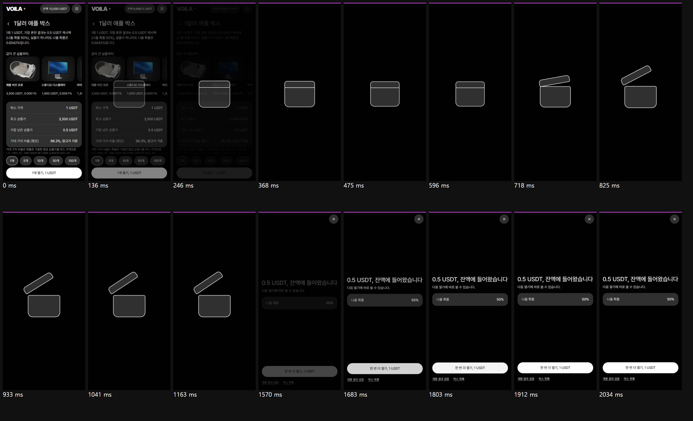
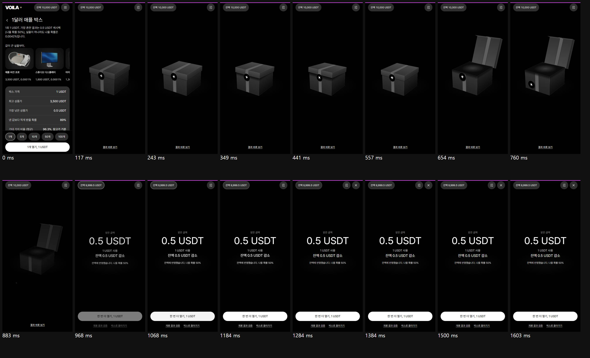
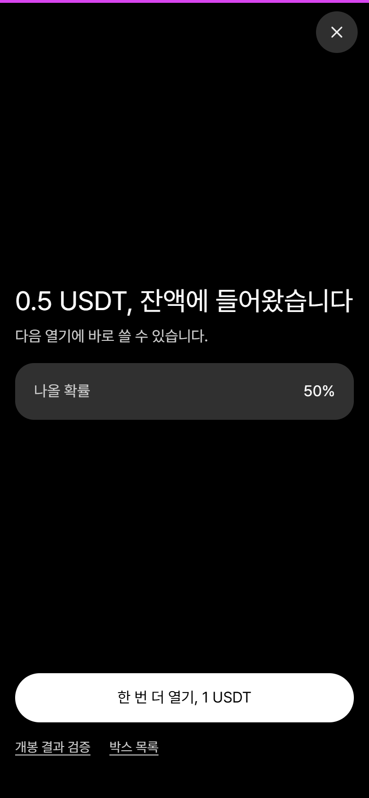
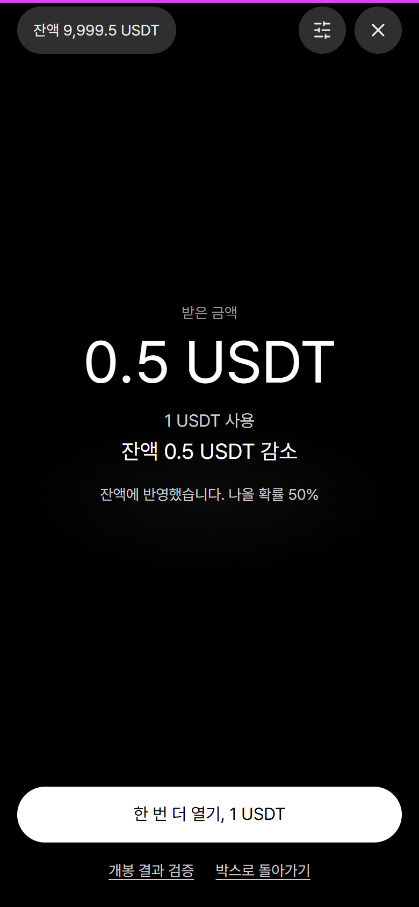
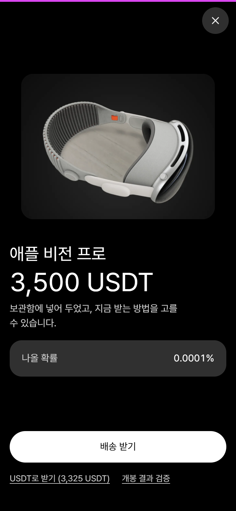
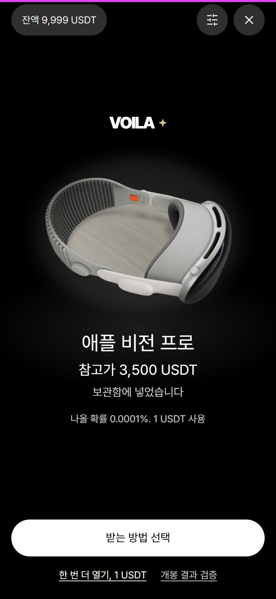
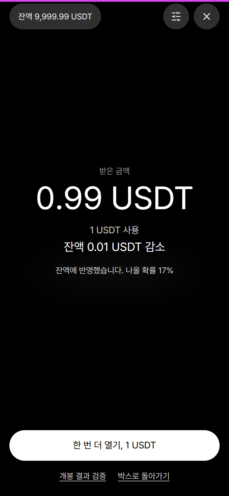
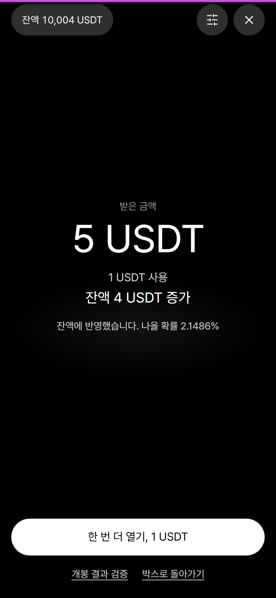
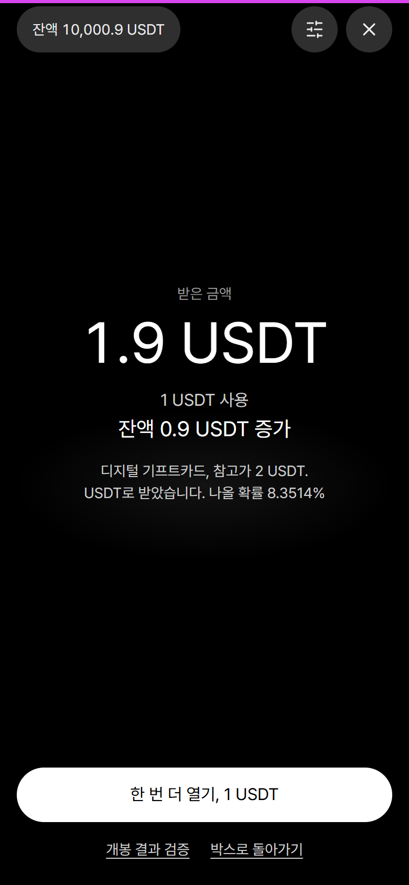
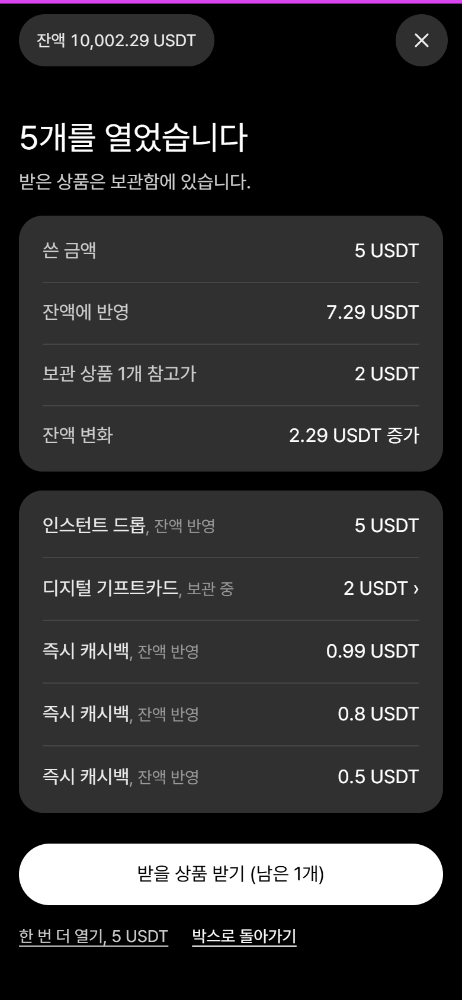

# VOILA 박스 개봉 경험: 최종 보고 (2026-10-11)

> **2026-10-11 덧붙임.** 이 보고서를 낸 뒤 파운더가 확률 변경을 지시했고 운영 표를 두 번 바꿨다. 지금 표는 사다리다(받는 값 기준 99%, 당첨 구간 1배에서 500배, 구간마다 상품이 먼저, 기프트카드 구간 삭제). 결과 화면에는 배수 표기와 여러 개 결과의 "가장 큰 결과"가 더해졌다. 그 뒤 터짐 게이지(슬롯의 누적 상금과 같은 구조)를 더했다. 아래 본문의 "확률은 바꾸지 않았다", "89%", "0.5배", "0.0001%" 는 그 전 표의 기록이다. 지금 숫자는 `opening/ODDS.md`, 결정 기록은 `opening/DECISIONS.md` 맨 아래에 있다. 증거 화면(`opening/evidence/`)은 옛 표로 찍은 것이고, 새 표로 다시 찍은 화면은 `opening/evidence-odds/` 에 있다.

테스트 사이트 https://shinwon446-eng.github.io/voila-test-aresjoo/ko/box/dollar-apple/ 에서 직접 열어 볼 수 있다(시험 장부라 실제 돈은 없다).
화면 증거는 전부 실제 브라우저에서 찍었고 `opening/evidence/` 에 있다. 결정의 근거는 `opening/DECISIONS.md`, Codex 원문은 `opening/codex/` 에 있다.

## 먼저 알아야 할 한계
- **녹화 파일이 없다.** Playwright 의 녹화용 ffmpeg 가 이 PC 에 없고, 내려받기는 파운더의 허락이 필요해 하지 않았다. 대신 브라우저가 보낸 실제 프레임을 받아 필름 띠(프레임 16장과 누른 뒤의 ms)로 남겼다.
- **실제 휴대폰에서 보지 못했다.** 성능은 데스크톱 크롬에서 CPU 를 4배 느리게 해 쟀다. iOS 사파리, 실제 기기의 진동, 소리가 실제로 어떻게 들리는지는 확인하지 못했다.
- **서버가 없다.** 이 사이트의 장부(지갑, 보관함)와 추첨은 브라우저 안에 있다. "서버가 결과를 정한다"는 요구는 "연출과 무관한 구매 모듈이 결과를 먼저 정하고 보관함에 적는다"로 옮겼다. 보관함과 지갑의 저장을 하나로 묶는 일은 브라우저 저장소로는 하지 못했다.
- **Reddit 스레드 넷은 열지 못했다.** 연구 요약에서 가챠 이용자 반응 부분의 근거가 가장 약하다.
- **확률은 바꾸지 않았다.** 모델 셋은 계산과 시뮬레이션뿐이다.

## 1. 전과 후

| | 전 | 후 |
|---|---|---|
| 작은 결과의 필름 |  |  |
| 작은 결과 화면(1 USDT 내고 0.5 USDT) |  |  |
| 가장 큰 상품(확률 0.0001%) |  |  |

무엇이 왜 바뀌었나
- **상자.** 148px 테두리 도형이 면 여섯 개의 입체 상자가 됐다. 리본과 로고 별이 박힌 봉인이 있다. 상자가 내려앉고, 봉인이 버티다(별이 감기고 뚜껑이 두 번 들썩인다) 앞으로 떨어지고, 뚜껑이 뒤로 넘어가고, 상자가 통째로 물러난 자리에 받은 것이 나온다.
- **결과가 말하는 것.** 전에는 1 USDT 를 내고 0.5 USDT 를 받아도 "0.5 USDT, 잔액에 들어왔습니다"뿐이었다. 지금은 받은 금액 바로 아래에 "1 USDT 사용"과 "잔액 0.5 USDT 감소"가 같은 순간에 나온다. 0.99 를 받으면 "0.01 USDT 감소"다. 본전으로 올림하지 않는다.
- **잔액.** 전에는 결과 화면에 잔액이 없었다. 지금은 왼쪽 위에 늘 있고, 결과가 드러나는 순간 최종 값으로 바뀐다.
- **받는 일.** 전에는 상품을 받으려면 단추, 확인창, 그 뒤에야 다시 열기였다. 지금은 같은 화면의 시트에서 배송과 USDT 를 나란히 놓고 고른 뒤 금액이 적힌 단추 하나로 끝낸다. 여러 개를 열었을 때도 보관함으로 가지 않고 그 자리에서 받는다.
- **끊겼을 때.** 전에는 연출 중 새로 고치면 무엇이 나왔는지 다시 볼 수 없었다. 지금은 박스 화면이 "보지 못한 개봉 결과가 있습니다"라고 말하고, 새로 뽑지 않고 그 결과를 다시 보여 준다.
- **구매 전.** 박스 화면에 "낸 값보다 적게 받을 확률 89%"를 직접 적었다. 전에는 가장 흔한 결과 하나의 50% 만 있었다.

## 2. 연구 요약 (`opening/RESEARCH.md`)
근거가 뒷받침하는 것
- 낸 값보다 적게 받은 결과에 승리 연출이 붙으면 사람들은 그것을 이긴 것으로 센다(Dixon 2010, Myles 2023). 소리로 구분해 주면 바르게 읽는다(Dixon 2015).
- 승리에 붙는 시청각 단서는 더 위험한 선택을 하게 하고 확률 정보를 덜 보게 한다(Cherkasova 2018). 루트박스 실험에서 강한 소리는 개봉 횟수를 늘렸다(Kao).
- 아슬아슬한 실패는 더 불쾌한데도 계속하고 싶게 만든다(Clark 2009).
- 0.1초 안의 반응은 즉각으로 느껴진다. 자주 보는 움직임은 짧아야 한다(NN/g).
- 피드백을 무작정 키우면 동기가 오히려 떨어졌고, 성공에 연동된 피드백은 올렸다(Kao 외 2024).

가설일 뿐인 것
- "이 연출이 도파민을 올린다", "기대 구간이 길수록 가치가 크게 느껴진다", "1.5초에서 3초가 최적". 화면을 직접 잰 근거를 찾지 못했다.

그래서 한 것
- 기대 구간은 결과와 무관하게 같다. 낮은 결과에 높은 신호를 주는 연출, 다른 상품이 스쳐 가는 띠, 아슬아슬하게 멈추는 연출은 없다.
- 축하 요소(밝은 빛, 넓어지는 바닥 빛, 올라가는 음)는 실제로 늘었을 때만 쓴다.
- 소리와 진동은 기본 끔이다. 강한 소리가 개봉을 늘린다는 근거가 있어 켜도 음량이 낮고 화려하지 않다.
- 자동 연속 개봉은 만들지 않았다. 다음 열기는 언제나 사람이 누른다.

Codex 는 이 요약의 여덟 결정을 하나씩 반박했고(`codex/round-a.md` 18~25) 대부분 받아들였다. 가장 큰 수정 셋: 소리 기본값을 끔으로, 반복 횟수에 따른 자동 단축을 사용자가 켜는 설정으로, "상품의 USDT 전환 가능액"과 "이미 받은 USDT"를 구분.

## 3. 흐름

```
박스 화면 (가격, 낸 값보다 적게 받을 확률, 상품)
  └ "1개 열기, 1 USDT"  (50 USDT 이상이거나 10개 이상이면 확인창)
       └ 구매 모듈이 결과를 정하고 차감, 보관함 기록(개봉 번호 포함), USDT 결과 지급을 한 번에
            └ 상자 연출 0.84초 (언제든 "결과 바로 보기")
                 └ 받은 것 + 쓴 금액 + 잔액 변화 + 바뀐 잔액
                      ├ USDT 결과: 이미 잔액에 있다 → "한 번 더 열기, 1 USDT"
                      └ 상품: "받는 방법 선택" → 시트에서 배송 또는 USDT → 금액이 적힌 단추 하나 → 같은 화면이 받은 금액으로 바뀐다
```

- 화면 상태는 `lib/openingFlow.ts` 의 표를 따른다. 새 구매는 READY 와 SETTLED 에서만 시작한다. 연출 중, 처리 중, 확인창이 떠 있는 동안, 못 본 결과가 있는 동안에는 구매가 나가지 않는다.
- 결과가 뜬 뒤 0.35초 동안은 아래 단추와 링크가 눌리지 않는다(건너뛰려던 손가락이 다음 구매를 누르지 않게).
- 자동으로 USDT 로 받기는 설정에서 기준을 다시 보여 주는 확인을 거쳐야 켜진다. 그 계정에만 적용되고, 낸 값의 20배 이상인 상품은 자동으로 넘기지 않고 묻는다.

## 4. 결과별 화면

| 결과 | 화면 | 다른 점 |
|---|---|---|
| 줄어듦 (0.5배) |  | 열린 틈의 빛이 옅다. 소리는 여는 소리뿐. "잔액 0.5 USDT 감소" |
| 거의 같음 (0.99배) |  | 같은 크기, 같은 대비. "잔액 0.01 USDT 감소" |
| 늘어남 (5배) |  | 틈과 바닥의 빛이 밝다. 올라가는 음 둘. "잔액 4 USDT 증가" |
| 낸 값의 20배 이상 |  | 서비스 이름, 상품, 이름이 한 장의 구도. 상품 뒤 테 빛이 한 번 번지고 상품만 천천히 다가온다 |
| 상품을 USDT 로 받은 뒤 |  | 가장 큰 글자는 실제로 받은 1.9 USDT |
| 다섯 개 |  | 쓴 금액, 잔액에 반영, 보관 상품, 잔액 변화를 나눠 적는다 |

필름: [작은 결과](evidence/after-small-film.png), [5배](evidence/after-x5-film.png), [가장 큰 상품](evidence/after-top-film.png), [50 USDT 박스의 가장 큰 상품](evidence/after-gold-top-film.png).
연속 열기(작음, 작음, 작음, 2배): `evidence/seq-01.png` 부터 `seq-04.png`.

작은 결과와 큰 결과의 금액 글자 크기는 같다. Codex 가 "89% 가 보는 화면을 덜 완성된 상태로 두지 마라"고 했고 옳았다. 정직함은 초라함이 아니라 정확함으로 낸다.

## 5. 확률 모델 (`opening/PROBABILITY.md`, 표는 `opening/PROBABILITY-tables.md`)
**승인이 필요하다. 아무것도 켜지 않았다.**

| | 지금 | A 고른 분포 | B 큰 변동 | C 최저 보장 |
|---|---:|---:|---:|---:|
| 낸 값보다 적게 받을 확률 | 89.0% | 61.1% | 67.6% | 78.2% |
| "적게 받음"이 10번 이어질 확률 | 31.2% | 0.7% | 2.0% | 8.6% |
| 낸 값의 10% 이하를 받을 확률 | 0% | 0% | 45.6% | 0% |
| 1,000회 묶음에서 운영자가 잃은 비율 | 9.1% | 5.0% | 26.1% | 4.3% |

기대 지급률은 넷 다 95% 로 맞췄다. 10만 회 시뮬레이션이 이론값과 맞고, Codex 가 식과 구현을 따로 검산했다.
권고: 바꾼다면 A 를 출발점으로. B 는 파운더가 든 예를 그대로 옮긴 것인데, 절반 가까이가 낸 값의 10% 이하를 받고 운영자의 묶음 손실도 가장 잦아 그대로는 권하지 않는다. C 의 보장 문구는 A 에도 쓸 수 있다.

## 6. 구현

| 파일 | 하는 일 |
|---|---|
| `web/components/box/Opening.tsx` | 한 개 열기의 장면과 결과, 받는 방법 시트, 개봉 설정 |
| `web/components/box/Reveal.tsx` | 여러 개 열기(같은 상자, 영수증 요약, 그 자리 받기) |
| `web/components/box/BoxScreen.tsx` | 상태 기계 연결, 못 본 결과 안내와 복구, 손실 확률 행 |
| `web/app/opening.css` | 상자와 장면. transform 과 opacity 만 움직인다 |
| `web/lib/openingFlow.ts` | 결과의 크기(톤), 영수증 기반 잔액 변화, 연출 길이, 상태 표 |
| `web/lib/opening.ts` | 구매 모듈. 계정 고정, 실패 시 통째로 되돌리기, 개봉 번호 |
| `web/lib/ledgerLock.ts` | 계정별 장부 잠금(여러 탭), 저장소 쓰기 확인 |
| `web/lib/openingSettle.ts` | 결과 자리에서 USDT 로 받기(끝남, 대기, 실패) |
| `web/lib/openingSound.ts` | 소리와 진동(Web Audio 로 그 자리에서 만든다) |
| `web/stores/openingJournal.ts` | 본 개봉의 목록. 못 본 개봉은 보관함 기록에서 찾는다 |
| `web/stores/settingsStore.ts` | 소리, 짧게 보기(기기), 자동 받기와 지난 방법(계정별) |

돈과 관련해 지키는 것
- 결과는 연출 전에 정해져 보관함에 적힌다. 건너뛰어도, 닫아도, 새로 고쳐도 바뀌지 않는다.
- 같은 순간의 여러 번 누름은 구매 한 번이다. 받기를 두 번 눌러도 한 번만 더해진다.
- 구매가 어디서 실패하든 지갑과 보관함은 열기 전 상태로 돌아간다.
- 구매 도중 계정이 바뀌면 어느 계정에서도 차감하지 않는다.
- 두 탭이 같은 장부를 쓸 때 서로 덮어쓰지 않는다.
- 잔액에 들어오기 전에는 "받았다"고 말하지 않는다.

## 7. Codex 의 비평
세 번 받았다. 동의를 구한 것이 아니라 반박을 요구했고, 실제로 내 판단이 여러 번 뒤집혔다.

**라운드 A, 시안 비평.** 시안 셋(봉인 상자, 빛의 틈, 막)을 실제로 만들어 필름으로 보였다. 나는 셋을 섞으려 했다. Codex 는 "섞으면 단계만 늘어난다, 기대 구간의 빛은 모두에게 같이 준다고 중립이 되지 않는다"며 봉인 상자 하나만 남기는 넷째 안을 냈고 그것을 채택했다. 받아들인 것: 받은 값과 차이를 같은 순간 같은 자리에, 줄었는데 잔액이 올라가는 움직임 제거, 작은 결과를 초라하게 만들지 않기, 상품의 주 단추를 "USDT로 받기"에서 "받는 방법 선택"으로, 보이는 건너뛰기, 소리 기본 끔.

**라운드 B, 구현과 확률.** "통과 판정을 내릴 수 없다"였다. 실제 결함을 찾았다.
- 여러 개를 연 뒤 다시 열 수 없었다. 내가 반복 1 에서 만든 버그이고, 내 검수는 "단추가 켜져 있다"만 보고 통과시켰다.
- 구매 도중 계정이 바뀌면 다른 계정에서 차감됐다.
- USDT 결과를 더한 뒤 실패하면 돌려준 값이 남았다(잔액 100 이 125).
- 두 탭이 서로의 구매를 덮어썼다.
- 자동 받기 동의가 같은 기기의 다른 계정에 적용됐다.
- 확률 문서에서 지금 구조의 표준편차를 72.2 로 적었는데 실제는 126.6 이었다(드문 결과 47종을 평균 한 줄로 묶은 탓).
전부 고치고 단위 테스트와 화면 검수에 재현을 넣었다.

**라운드 C, 화면 적대 검수.** 화면 31장에 66점(기준 화면 46점). 받아들인 것: USDT 로 받은 뒤에는 받은 금액이 가장 크게, 여러 개 결과를 영수증으로 나눠 적기, 구매 전에 89% 를 적기, 잔액은 세어 올리지 않고 최종 값만, 봉인과 뚜껑과 몸체의 연결, 큰 결과 앞의 어두운 정지 제거.

받아들이지 않았거나 다 하지 못한 것
- 받는 방법을 고른 뒤 확인창을 한 겹 더 두는 것: 시트를 열고, 방법을 고르고, 금액이 적힌 단추를 누르는 것이 이미 확인이라고 보고 두지 않았다.
- 자금 출처 비율의 0.01 USDT 반올림: 원래 있던 돈 계산이라 손대지 않았다(아래 9).
- 보관함과 지갑의 저장을 하나로 묶기: 브라우저 저장소로는 못 한다.
- 상자의 재질: 접힌 리본과 그림자를 넣었지만 여전히 CSS 면이다.
- 모든 결과 화면에 서비스 표식: 큰 결과에만 넣었다.
- 반복 2 의 수정에 대해 Codex 의 재검수는 받지 않았다. 고친 것은 내 검수와 단위 테스트로 확인했다.

## 8. 검수 증거
- 단위 테스트 306 통과(`npm test`). 그 가운데 개봉 규칙과 구매 보호 장치 10개가 이번에 생겼다.
- design-lint 0, 타입 검사 통과.
- 화면 검수 83개 항목 통과: `node scripts/capture/opening-qa.mjs <폴더>`. 결과는 `opening/evidence/qa-results.json`.

| 묶음 | 확인한 것 |
|---|---|
| 흐름 | 확인창 취소 시 돈이 안 움직임, 닫은 뒤 실제로 다시 열림, 거래 기록과 보관함 기록이 같은 개봉 번호 |
| 결과 넷 | 잔액이 계산과 같음, 줄었으면 감소라고 적음, 가로 넘침 없음 |
| 누름 | 연달아 세 번 눌러도 구매 한 번, 결과 직후 누름(단추, 링크, 키보드)이 실행되지 않음, 건너뛰어도 결과가 같음 |
| 받기 | 2 USDT 상품을 1.9 로, 두 번 눌러도 한 번, 자동 받기(켬, 끔, 20배 이상, 다른 계정) |
| 막힘 | 잔액 부족, 구매 실패 뒤 정상 복귀, 잔액 반영 대기, 받기 실패 뒤 다시 시도 |
| 끊김 | 연출 중 새로 고침 뒤 같은 결과, 새 구매 없음, 본 뒤에는 다시 묻지 않음, 여러 개 열기도 같음 |
| 연속 | 여섯 번 연속의 잔액, 움직임 줄이기, 여러 개 열기 뒤 다시 열기와 그 자리 받기 |
| 폭 | 320, 360, 375, 390, 430, 768, 1440 에서 겹침과 잘림 없음. 영어와 중국어 320 |
| 성능 | 프레임 평균 16.7ms. CPU 4배 느리게 18.0ms. 누른 뒤 결과까지 0.89초(느리게 1.04초) |
| 두 탭 | 두 탭에서 한 번씩 열어도 구매 둘, 기록 둘, 회차 둘 |

필수 화면 18가지: `evidence/01-box-selection.png` 부터 `18-recovered.png`. 연출 중간 프레임(5~8번)은 필름 띠에 있다.
화면 폭별: `evidence/bp-top-*.png`, `evidence/bp-small-*.png`.

남은 문제
- 실제 휴대폰, iOS 사파리, 가로 화면, 큰 글자 확대에서 보지 못했다. 결과 영역은 내용이 넘칠 때 스크롤되지 않는다.
- 소리와 진동은 오류 없이 돈다는 것까지만 확인했다.
- TV 처럼 어두운 상품은 어두운 배경에서 윤곽이 약하다.
- 한 개 결과와 여러 개 결과의 주 단추 높이가 조금 다르다.

## 9. 권고와 파운더가 정할 것
새 장면이 원래 것보다 나은 이유는 효과가 많아서가 아니다. 무엇을 열었는지 보이고, 무엇을 받았고 잔액이 어떻게 됐는지가 한 번에 읽히고, 받는 일이 그 자리에서 끝나고, 끊겨도 결과를 잃지 않기 때문이다. 빛의 틈 시안은 충격이 상자를 지워 결과가 어디서 나왔는지 끊겼고, 막 시안은 개봉이라는 사건이 없어 로딩처럼 읽혔다.

정해 주실 것
1. **확률 구조.** 지금대로 둘지, A 를 출발점으로 바꿀지. 지금 구조에서는 열 번에 아홉 번이 줄어드는 결과라 어떤 연출도 그 빈도를 바꾸지 못한다.
2. **"디지털 기프트카드".** 코드를 받는 길이 없고 USDT 로만(95%) 받을 수 있다. 실제 카드를 줄 것이 아니면 USDT 결과로 이름을 바꾸는 편이 정직하다.
3. **자금 출처 반올림.** 암호화폐와 카드를 섞어 낸 구매에서 USDT 로 받을 때 출처별 몫이 0.01 USDT 어긋날 수 있다(합계는 맞다). 원래 있던 계산이고 "돈 계산은 그대로"라는 지시 때문에 손대지 않았다.
4. **녹화.** ffmpeg 를 내려받아도 되면 실제 녹화 파일을 만들 수 있다.
5. **상자 그림.** 지금 상자는 CSS 로 그린 것이다. 사진 같은 재질을 원하면 상품 사진처럼 생성 이미지나 3D 자산이 필요하다.
6. **서버 장부.** 진짜 돈을 받기 전에는 구매, 지급, 보관함을 한 거래로 묶는 서버 장부가 있어야 한다.
